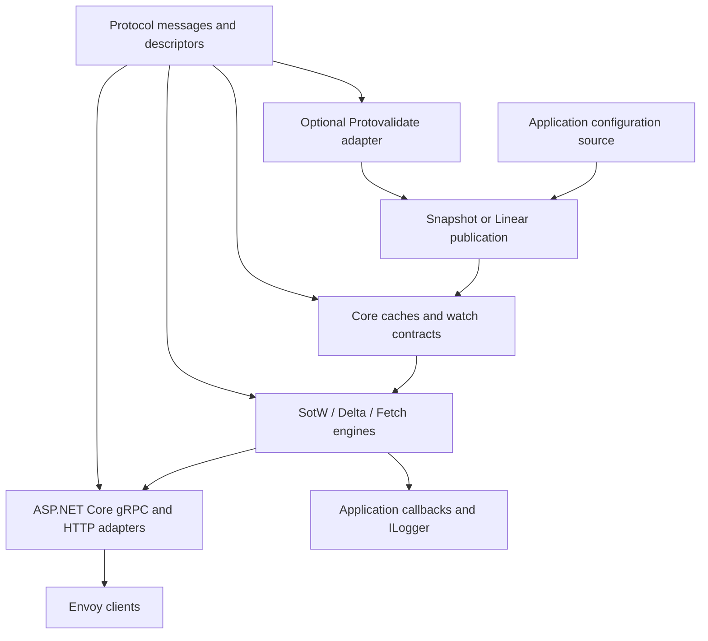

# Detailed architecture

Reviewed **24 October 2026**. Status: proposed design, with no implementation results. This document uses the Go behavior pin and the separate Envoy schema pin in [upstream-baseline.json](../../upstream-baseline.json). Requirements, task IDs, and verification IDs are defined in [traceability](../plan/TRACEABILITY.md) and the [implementation plan](../plan/IMPLEMENTATION-PLAN.md).

## 1. Purpose and compatibility contract

Provide an independent .NET library that applications embed to deliver caller-supplied Envoy configuration. Match observable behavior of the maintained v3 **root Go library**: caches, discovery servers, fetch transports, extension points, helpers, and the small SotW ADS client. Reproduce protocol outcomes and relevant defaults while using ordinary .NET asynchronous APIs.

The library does not translate a database or service catalog into Envoy configuration. Applications own configuration generation, authorization, durable storage, leader selection, and deployment. The built-in caches are process-local. A restarted host reconstructs them from the application's source; client initial versions and resubscription participate in convergence.

Three compatibility axes are published separately:

| Axis | Recorded evidence |
|---|---|
| Go behavior | Exact commit and in-scope surface from the [parity matrix](../plan/PARITY-MATRIX.md) |
| Schema support | Exact Envoy/import/ratelimit revisions, binding toolchain, selected input catalog, descriptor fingerprints |
| Envoy interoperability | Released proxy versions and immutable image digests exercised by integration scenarios |

Preview includes SnapshotCache, SotW services/ADS, and a minimal host/example. Version 1.0 completes the root-library matrix. Matcher evaluation, full legacy/contrib catalogs, and PGV method-shaped APIs are separate extensions. Optional Protovalidate integration has its own acceptance gate; its design and provider proof are part of this plan.

SotW means **state of the world**: a response describes the subscribed state for a resource type under that type's rules. Delta sends changed resources with per-resource versions and explicit removals. ADS multiplexes resource types over one stream; it is available independently with SotW or Delta. ADS does not create a transaction across resource types.

## 2. Packages and dependencies



| Package | Owns | Must not own |
|---|---|---|
| `Envoy.ControlPlane.Protocol` | One authoritative set of generated messages, descriptors, gRPC client/server contracts; required annotation definitions | Cache state, CEL evaluator, ASP.NET host policy |
| `Envoy.ControlPlane` | Resource catalog, snapshots, caches, watches, subscriptions, protocol engines, callbacks, fetch logic, conversion helpers, ADS client wrapper | Kestrel startup, HTTP routing, storage, process-wide mutable registries |
| `Envoy.ControlPlane.AspNetCore` | Concrete generated service adapters, DI registration, endpoint mapping, HTTP/JSON gateway | Independent protocol state machines |
| `Envoy.ControlPlane.Validation.Protovalidate` — optional | Provider adapter, validation diagnostics, explicit validated-publication decorator | A second set of Envoy message classes; mandatory CEL dependency for core consumers |

Core targets .NET 10 provisionally. Protocol may use a wider compatible target after the package-consumption proof. Pin actual package/compiler versions during T02/T04; no floating dependencies. Core uses Google.Protobuf contracts, the chosen gRPC abstractions, logging abstractions, and `TimeProvider`. The client accepts an application-owned call invoker; it does not force an HTTP channel implementation on cache-only applications.

Proposed repository layout; the paths below do **not** exist as implementation yet:

```text
src/Envoy.ControlPlane.Protocol/          generated binding facade or owned outputs
src/Envoy.ControlPlane/                  Resources, Cache, Server, Client, Conversion
src/Envoy.ControlPlane.AspNetCore/       Services, Http, DependencyInjection
src/Envoy.ControlPlane.Validation.Protovalidate/  optional adapter
tests/                                  unit, differential, transport, Envoy, package tests
examples/MinimalControlPlane/            runnable host and Envoy bootstrap
schemas/                                input manifests, lock data, controlled overlays
scripts/                                generation, descriptor checks, interop, upstream updates
eng/                                    pinned SDK/package/build configuration
docs/                                   design, usage, compatibility and evidence
```

## 3. Protocol catalog and ownership

T02 chooses one provider: an existing generated SDK only if its exact schema content, full required service surface, restore, packaging, and descriptor ownership can be demonstrated; otherwise use repository-owned pinned generation. Consumers install built packages. Generated contracts must expose server bases and the client contracts required by the root surface, including ratelimit configuration discovery.

Select a standard Envoy input catalog that includes usable common extensions. Starting only from discovery request imports omits messages carried inside `Any`, including HCM/router/TLS configuration. Record the full input list, transitive dependency revisions, exclusions, licensing notices, tool versions, and output hashes. Resolve the original ratelimit schema source independently of `envoy/COMMIT`. Active extension dependencies may have version names other than v3; do not filter by directory spelling alone.

`IMessage` resources and `Any` extension payloads remain supported. Use an application-scoped descriptor registry assembled at startup, then treated as immutable. Reject duplicate protobuf full names with conflicting descriptors. Binary paths preserve unknown fields using the protobuf runtime; JSON conversion requires registered descriptors for embedded `Any` types and may reject unresolved types. Do not silently convert unknown `Any` payloads into empty messages.

Validation metadata belongs to the same descriptor universe. T03 decides whether a controlled dual-annotation overlay can be generated without conflicting annotation classes supplied by a .NET runtime. Details are in [validation](VALIDATION.md). The implementation cannot ship original and migrated Envoy message assemblies together as a workaround.

## 4. Proposed contracts

Names and signatures below describe responsibilities, rather than a frozen API. Freeze public contracts after G1. Actual generated service signatures come from the selected bindings.

```csharp
public interface INodeHasher { string Hash(Node? node); }

public interface IResourceSnapshot
{
    string GetVersion(string typeUrl);
    IReadOnlyDictionary<string, ResourceEntry> GetResources(string typeUrl);
    IReadOnlyDictionary<string, string> GetResourceVersions(string typeUrl);
}

public interface IConfigWatcher
{
    IWatch<SotwResponse> CreateWatch(DiscoveryRequest request, SubscriptionView subscription);
    IWatch<DeltaResponse> CreateDeltaWatch(DeltaDiscoveryRequest request, SubscriptionView subscription);
}

public interface IWatch<T> : IAsyncDisposable
{
    ValueTask<T> WaitAsync(CancellationToken cancellationToken);
}

public interface IConfigFetcher
{
    ValueTask<FetchResult> FetchAsync(DiscoveryRequest request, CancellationToken cancellationToken);
}
```

`ResourceEntry` holds a name, resource message, and optional TTL. `SubscriptionView` is an immutable view of exact names, prefix subscriptions, wildcard state, and returned name/version metadata. The cache must not mutate it. Response envelopes retain the originating effective request, optional context/correlation, type URL, version, returned metadata, and lazy materialization. Delta envelopes also retain changed resources and removals. Provide pass-through envelopes for custom caches returning prebuilt messages; clone a response before adding a stream-specific nonce.

`IWatch` is a one-shot asynchronous result with idempotent cancellation/disposal. It can already be completed when returned. Immediate response, pending response, cancellation, and cache failure are distinct outcomes. Waiting must not require a network writer to run synchronously inside cache publication. An adapter cannot reject a legitimate immediate cache response because the stream has not yet assigned its watch generation.

Use `FetchResult` with `Response` and `NotModified` cases. Model unsupported fetch, missing classifier, missing snapshot, materialization failure, and callback rejection separately; preserve transport mappings rather than flattening every failure into `InvalidArgument`. Exceptions may expose library error types internally; host adapters own transport translation.

Callbacks expose open, request, response, close, fetch-request, and fetch-response hooks in corresponding SotW/Delta forms. Use asynchronous completion in the protocol path. Open/request hooks can reject. Response/close notification failure policy must be fixed in T09: recommended behavior is log and terminate the affected stream on a response-hook fault, log a close-hook fault after cleanup, and never leave watches alive. These exception behaviors are explicit .NET departures because Go response/close hooks do not return errors. Callbacks that mutate the effective request/response remain in path; document mutation boundaries before freezing the API.

## 5. Resource ownership and versioning

Generated protobuf objects are mutable. Built-in snapshot construction defensively clones resources and retains private copies; public retrieval returns clones or safe views that cannot mutate cached messages. This is a proposed .NET ownership improvement, not a claim that Go clones resources. Custom snapshots must provide the same lifetime stability or explicitly transfer ownership. No exposed object can invalidate a lazy serialization/hash cache after publication.

Cache serialization and per-resource hashes are computed at most once per immutable entry, with thread-safe lazy storage. Do not cache a stream nonce in shared serialized data. Per-type snapshot versions are caller-supplied opaque strings. LinearCache maintains its own version counter with an optional instance prefix. Delta resource versions use an opaque content-version strategy. Default Go SHA256 is over deterministic protobuf bytes; cross-language equality is unproven. Test semantic equality and version relationships first; expose an explicit resource-version strategy if exact existing versions are a consumer requirement.

`Snapshot.Consistent` remains opt-in and checks the source's EDS/RDS reference-set conditions. A partial snapshot can be valid for a consumer. `SetSnapshot` does not automatically call consistency or a validator. Reference extraction, semantic protobuf validation, xDS ACK/NACK, and Envoy runtime acceptance are separate checks.

## 6. Cache algorithms

### 6.1 SnapshotCache

State is keyed by `INodeHasher`; default behavior is `Node.Id`, with empty string for absent node. Each node entry holds an immutable snapshot reference, SotW and Delta watch indexes, and status timestamps/counters. Node metadata is copied when retained for status. Clear removes snapshot and status according to source semantics; it does not synthesize deletion responses.

Publication algorithm:

1. Construct/clone a complete candidate outside locks. An explicitly selected validation decorator validates that candidate here.
2. Lock the node entry; atomically replace its snapshot reference, evaluate eligible watches against that reference, claim one-shot completions, and update indexes/status.
3. Release locks. Complete watch tasks and perform any materialization that does not require protected mutable state. Continuations run asynchronously.
4. Return publication status. Cache publication is complete without waiting for Envoy to receive, ACK, or apply the change.

Watch registration and snapshot lookup occur under the same node synchronization so an update between lookup and registration cannot be lost. Response eligibility includes snapshot version, resource selection, subscriptions, and ADS readiness. If no snapshot exists, register a pending watch. Preserve the source's special ADS partial-name edge: a request for missing resources may return neither a response nor a registered watch. Represent that as a pending cancelable wait without falsely reporting an indexed cache watch; capture the case in V09 before considering a behavior change.

Default snapshots support the resource families mapped by `GetResponseType`; arbitrary type constants alone do not add snapshot storage slots. Custom resource types use custom snapshot/cache implementations or LinearCache/MuxCache. Generic ADS dispatch remains type-URL based.

### 6.2 LinearCache

Owns a single type URL and shared resource collection, with exact/prefix/wildcard watch indexes and a version prefix/counter. Implement initial resources, update, delete, bulk change, and replace-all operations. Compute candidate changes before locking; under the lock install one internally consistent collection and claim relevant completions. Define duplicate/missing-name errors and no-op version behavior from the source fixtures. Track per-resource hashes for Delta and collection versions for SotW. `Fetch` returns the source's unsupported-operation result.

### 6.3 MuxCache

Routes SotW and Delta through separately configurable classification functions and delegates fetch using the source's selection contract. Classifier output selects a registered child cache; missing keys are errors. Child caches remain independently owned unless explicitly registered with ownership transfer. The mux must not hide LinearCache's unsupported fetch or invent an aggregate snapshot transaction.

### 6.4 Status

Expose copied node status: identity, SotW/Delta watch counts, last respective request times, and node lists. Use `TimeProvider.GetUtcNow()` for observable timestamps. Counters must reflect register/complete/cancel/clear paths, including immediate responses and the special ADS no-registration case. Status inspection is not a durable record of client acceptance.

## 7. Watch delivery and concurrency

Each active stream/type owns at most one current watch generation. Each watch has one result slot. Cache publication completes a task slot rather than writing to a network channel. There is one stream event loop and one response writer per stream. Request reading can run concurrently but feeds a bounded mailbox; the event loop drains already-completed responses according to mode before installing a replacement watch. Never wait for mailbox capacity or a socket send while holding a cache lock.

Suggested ownership and lock rules:

| State | Owner / synchronization |
|---|---|
| Node lookup and entry creation | Short global map operation; no callbacks or await |
| Snapshot pointer, indexes, status for one node | Node lock; no callback, serializer, or network await |
| Linear resources/indexes | Linear collection lock with same restrictions |
| Stream node, nonce sequence, per-type subscription/watch generation | Stream event loop only |
| Immutable resource bytes/versions | Thread-safe lazy value, shared read-only |
| Callback invocation and response send | Event loop, outside all cache locks |

Lock order is global-map lookup followed by a node lock only when necessary; do not acquire global locks from a node lock. Mux dispatch never holds one child's lock while calling another. Use generation and subscription checks to prevent an obsolete SotW response after unsubscribe; the source intentionally discards some superseded SotW responses. Do not introduce arbitrary drops of current Delta updates. T14 must establish how pending Delta responses are drained before subscription mutation, following source behavior.

Backpressure stalls the affected stream. It must not stall unrelated nodes or publication indefinitely. Cap inbound mailbox and active custom type/watch counts via host options if needed; use explicit resource-exhaustion termination for a breached limit. Defaults/limits require documented host behavior because the Go source does not impose equivalent limits. Never silently evict a live watch or drop a protocol response to satisfy a capacity bound. A custom watcher that violates the one-shot contract fails that stream explicitly.

## 8. SotW state machine

```mermaid
stateDiagram-v2
    [*] --> Open
    Open --> Request: open callback accepts
    Request --> Request: stale nonce ignored after request callback
    Request --> Watching: normalize request and replace watch
    Watching --> Send: eligible response
    Send --> AwaitRequest: send completed; one-shot watch consumed
    AwaitRequest --> Request: next request
    Watching --> Request: next request
    Open --> Closed: rejection
    Request --> Closed: error or cancellation
    Watching --> Closed: EOF or cancellation
    AwaitRequest --> Closed: EOF or cancellation
    Send --> Closed: send failure
    Closed --> [*]: cancel watches and notify close once
```

For each request: restore the last node when omitted; preserve an explicitly supplied later node as Go does. Fill an absent per-type type URL; reject absent ADS type URL. Invoke the request callback at the source-equivalent point. A stale nonce for a type with a recorded response is ignored without replacing its watch. Cancel the old watch before updating the subscription. Register a new one with copied subscription metadata, then process a possible immediate result.

Sending checks that resources still match the current subscription, materializes a fresh response, assigns a stream-unique nonce, records returned-resource metadata at the source-equivalent send stage, invokes the response callback, and writes once. Failed writes close the stream. ACK/NACK details are visible to callbacks; do not invent an automatic rollback of a published snapshot. Snapshot versions and request versions control re-response; a NACK does not automatically blacklist a version in this library.

SotW resource selection is type-specific: clusters/listeners require the source's full-state behavior; do not apply one generic named-resource filter to every family. Legacy empty subscription initially means wildcard by default. After explicit SotW subscriptions, empty does not restore legacy wildcard. Exact names, `*`, and collection prefixes such as `collection/*` need distinct state.

## 9. ADS coordination

The unordered default shares the SotW engine with independent type watches. `OrderedAds=true` selects the source's ordered SotW ADS behavior: drain pending responses for other types when updating a type and preserve the source resource-priority policy and readiness conditions. Ordering does not promise that clients apply all types atomically. SnapshotCache's ADS readiness setting and the stream's ordering option are separate choices; configure and test both.

For ordered SotW ADS, tag results by watch generation, recheck subscriptions before sending, and retain other-type responses while removing superseded current-type results as allowed by the source. Make drain decisions explicit and observable in trace fixtures. A nonce is unique across the stream; last response association is maintained per type. Arbitrary custom type URLs must not depend on a fixed array sized only for known resource families.

Do not automatically apply this option to Delta: the reviewed source's `Ordered` selection occurs in the SotW path. Delta ADS uses its own multiplexed response processing.

## 10. Delta state machine

Per-type state contains subscription exact names/prefixes/wildcard, returned resource versions, first-request initialization state, current watch generation, and last sent nonce for observation. `InitialResourceVersions` seeds the first request of each type, not every subsequent request on that stream.

Process pending completed Delta responses before a new request, matching the Go engine. Its request callback runs before the source's node/type completion step; preserve that observable distinction from SotW. For a new type construct subscription state; otherwise cancel its previous watch before applying additions/removals. Pass the resulting immutable view into the cache.

Responses contain changed resources with versions, removed names, and a system version. A wildcard initial request may require an empty response. Update returned-resource tracking when a response is sent, as the source does. **The reviewed Delta loop does not implement SotW's stale-nonce rejection or a separate ACK-committed version ledger.** Record NACK information through callbacks and test the source behavior; do not share an imagined ACK state machine between modes. A spec/source discrepancy becomes a documented decision with fixtures, rather than a silent correction.

Subscription updates process subscribe then unsubscribe entries. Preserve the wildcard case where unsubscribing a previously explicit name forces an update/removal report even while wildcard remains active. Prefix subscription behavior and unsubscribe/re-subscribe without a resource change need dedicated cases. Reconnect creates a fresh stream and uses the client's provided initial versions.

## 11. TTL and heartbeats

Represent TTL independently from the resource payload. Materialize the correct xDS resource wrapper, optional duration, version, and payload omission for heartbeat responses. TTL is a proxy expiry instruction; the cache must not delete resources automatically merely because a duration elapsed.

The reviewed SnapshotCache periodic heartbeat loop scans **SotW watches only**. It sends TTL-bearing resources using the current snapshot version, omits the normal resource payload in heartbeat mode, preserves returned-resource metadata, and consumes the one-shot watch; the next client request creates another. Preserve its exact/prefix selection behavior using fixtures, rather than assuming every selection path is identical to normal responses. Delta resource TTL encoding is in scope; an additional automatic Delta heartbeat scheduler is not source parity.

Use an injected `TimeProvider` and a cache-owned timer. Only start it when heartbeat mode is enabled with a valid interval. Disposal cancels the timer and pending owned work, is idempotent, and prevents publication after shutdown. Tests advance a fake clock and explicitly demonstrate proxy expiry and refresh with a real Envoy.

## 12. Transports and error semantics

Generate thin adapters that map each supported method to its engine and implied type URL. The exact [RPC matrix](../plan/PARITY-MATRIX.md) is authoritative: eight standard resource families expose SotW/Delta/unary/HTTP; ADS exposes both streams; VHDS/LEDS are Delta only; rate-limit configuration has SotW and unary only, with no dedicated Delta or HTTP route. Do not register runtime implementations for unrelated generated services.

Unary fetch runs request callback, cache fetch, materialization, response callback, then transport return. Preserve the source's nil-request and cache-error semantics through fixture-based mapping. `NotModified` is a distinct cache outcome, not an empty discovery response. Linear/Mux limitations remain visible.

The HTTP gateway delegates to this same fetch engine. Use protobuf JSON with proto field names for output, registered `Any` descriptors, and the source parser's acceptance/rejection behavior. Verify Google.Protobuf JSON options against Go protojson; configure or adapt rather than assume equivalence. Route normalization uses source `path.Clean` semantics where feasible. The Go handler does not enforce an HTTP verb; any ASP.NET verb restrictions must be documented departures rather than accidental 405s.

| Condition | HTTP outcome |
|---|---|
| Unknown discovery path | 404 |
| Missing/unreadable body or invalid protobuf JSON | 400 |
| Unchanged cache version | 304, no response body |
| Other fetch/materialization/JSON failure | 500 |
| Successful fetch | 200, protobuf JSON |

Routes: `/v3/discovery:endpoints`, `:clusters`, `:listeners`, `:routes`, `:scoped-routes`, `:secrets`, `:runtime`, and `:extension_configs` (all share the `/v3/discovery` prefix). The route overrides a body-supplied type URL. Content type, body size, deadlines, and framework routing differences are explicit host settings with transport cases. gRPC cancellation uses the call cancellation token; no response can be written after stream termination.

## 13. ASP.NET Core integration and lifecycle

Proposed registration is `AddEnvoyControlPlane(...)` with application-provided cache, callback, descriptor-registry, and option instances, followed by separate gRPC and HTTP endpoint mapping. Runtime caches are shared singletons unless the application deliberately supplies another lifetime. Stream sessions are per-call objects. Avoid resolving scoped services once into a singleton; callbacks needing scoped services require a deliberate per-call factory.

Startup builds the descriptor registry, validates options, and starts explicitly enabled timers. Shutdown stops accepting calls, cancels sessions through a linked host token, cancels/disposes all watches, awaits reader/event-loop completion, and disposes owned timers/resources. Cleanup runs on open-hook rejection, EOF, reader failure, writer failure, callback failure, and host stop. Close notification occurs once after watch cleanup even if open was rejected, matching source lifecycle intent.

Authentication/TLS/authorization use ASP.NET Core facilities. Node ID is an application routing key, not proof of identity. The example binds node authorization in a request callback using the authenticated principal. Explicitly configured host limits and error-detail redaction are documented, not presented as Go protocol behavior. Core logs type/version/watch lifecycle information through `ILogger`; avoid full Secret payloads or node metadata in default logs. Metrics/tracing integrations can subscribe through callbacks; no mandatory telemetry exporter is needed for parity.

## 14. ADS client and helper surface

The client wrapper is a focused SotW ADS client for one node/type URL, using a caller-owned call invoker. Initialization opens the stream and sends the initial request. Receive stores the latest received response and returns resources. ACK records the latest response as accepted and sends its version/nonce. NACK retains the last accepted version, uses the latest received nonce, and includes the supplied error message. Serialize client operations and define concurrent-call rejection or locking explicitly.

Connection-error classification covers the source's EOF/Unavailable/Canceled categories. The wrapper does not invent a reconnect/backoff policy. Dispose its call/stream, never the application channel. Reinitialization and use-before-initialization have fixtures.

Resource helpers include name resolution, type URL constants, reference extraction (including HCM in Any), and well-known extension identifiers required by the mapped source. Conversion uses protobuf JSON rules for message/Struct round trips. Built-in resource catalogs and custom descriptor registration use one shared abstraction; avoid hardcoded assumptions in cache-independent helpers.

## 15. Optional validation

Use Protovalidate as the preferred optional validation direction. Applications explicitly select a validated-publication decorator; default raw `SetSnapshot` remains unchanged. The decorator validates all candidate resources before installing any of them. Return structured violations separately from descriptor/CEL runtime faults. Neither outcome is an xDS NACK; Envoy still performs its own acceptance checks.

The [validation design](VALIDATION.md) defines the .NET candidate comparison, PGV annotation migration, single-descriptor ownership, conformance corpus, diagnostic policy, and enablement gate. Do not claim existing Envoy PGV annotations become executable by adding a Protovalidate runtime alone. Exact Go `Validate`/`ValidateAll` API parity is outside the root runtime claim.

## 16. Verification, packaging, and upstream updates

Use named cases in [traceability](../plan/TRACEABILITY.md). The differential harness drives the pinned Go reference and .NET through equivalent scripted events and compares parsed resources, subscriptions, errors, callbacks, watch counts, and version/nonce relationships. Preserve stale relationships using consistent opaque-value mapping. Do not sort away protocol-required ordering or normalize away NACK/error differences. Use deterministic scheduling/barriers for races; a timeout is failure evidence, not proof of correct cleanup.

Run actual released Envoy images for initial bootstrap, update, NACK, reconnect/resubscribe, Delta removal, and TTL refresh/expiry. Inspect config dump and observable traffic/admin counters as well as control-plane logs. A successful TCP/gRPC connection alone is insufficient.

CI stages cover pinned generation/descriptor checks, compilation and unit cases, Go differential cases, transport/lifecycle cases, real Envoy, pack/clean-consumer tests, and a compatibility report. Choose test framework and platforms in T04; Linux runs Envoy containers, with Windows/macOS build and relevant host tests. Pin CI actions/toolchain and keep substantial logic in versioned scripts. Protocol package inputs and annotation/runtime choices must be reproducible in a clean environment.

Upstream update tooling fetches to the separate reference checkout, records old/new behavior and schema pins, reports changes, regenerates selected inputs, and runs required cases before accepting a new baseline. Keep historical evidence tied to its immutable pin. Package versioning follows public API/behavior compatibility; an incompatible schema/type-ownership change cannot be hidden as a patch update.

## 17. Risks and unresolved decisions

| Risk / decision | Required closure |
|---|---|
| SDK cannot prove exact schema/server-contract coverage | T02 selects owned generation; G1 blocks public API freeze |
| Ratelimit source provenance unresolved | T01/T02 identify revision and compare descriptors before bindings pass |
| Duplicate Envoy/annotation types across runtime dependencies | T02/T03 clean-consumer proof and dependency graph; one owner |
| Protovalidate migration changes rule semantics | T03 decision plus T26 conformance; optional adapter cannot claim Envoy equivalence until GV |
| Source behavior differs from protocol expectation | T21 creates divergence record and explicit decision; preserve baseline until approved change |
| Per-stream serialization or watch races lose progress | T06/T22 adversarial scheduling, watch/status leak checks |
| Generated catalog too large or contains unsupported language inputs | T02 explicit manifest/exclusions and consumer example; revisit coverage before release claim |
| Copying resources costs more than expected | T05 measure representative graphs, retain ownership safety; optimize only with evidence |
| .NET target, branding, matcher/contrib needed by a named consumer | Record requirement before relevant API/package publication; proposed defaults stand meanwhile |

## 18. Source anchors

All source anchors refer to Go commit `67c5345367582741334e34ffc66a561b0ce32946`; paths are in the separate upstream repository.

- [Cache contracts](../../../go-control-plane/pkg/cache/v3/cache.go), [snapshot](../../../go-control-plane/pkg/cache/v3/snapshot.go), [SnapshotCache and heartbeats](../../../go-control-plane/pkg/cache/v3/simple.go), [cached resources](../../../go-control-plane/pkg/cache/v3/cached_resource.go).
- [LinearCache](../../../go-control-plane/pkg/cache/v3/linear.go), [MuxCache](../../../go-control-plane/pkg/cache/v3/mux.go), [resource selection](../../../go-control-plane/pkg/cache/v3/resource.go), [status](../../../go-control-plane/pkg/cache/v3/status.go).
- [SotW default path](../../../go-control-plane/pkg/server/sotw/v3/xds.go), [SotW ordered ADS](../../../go-control-plane/pkg/server/sotw/v3/ads.go), [send path](../../../go-control-plane/pkg/server/sotw/v3/server.go), [Delta](../../../go-control-plane/pkg/server/delta/v3/server.go), [subscriptions](../../../go-control-plane/pkg/server/stream/v3/subscription.go), [options](../../../go-control-plane/pkg/server/config/config.go).
- [Service adapters](../../../go-control-plane/pkg/server/v3/server.go), [HTTP gateway](../../../go-control-plane/pkg/server/v3/gateway.go), [fetch engine](../../../go-control-plane/pkg/server/rest/v3/server.go), [ADS client](../../../go-control-plane/pkg/client/sotw/v3/client.go).
- [xDS specification](https://www.envoyproxy.io/docs/envoy/latest/api-docs/xds_protocol.html), [protobuf serialization limits](https://protobuf.dev/programming-guides/serialization-not-canonical/), [validation sources and assessment](VALIDATION.md).
