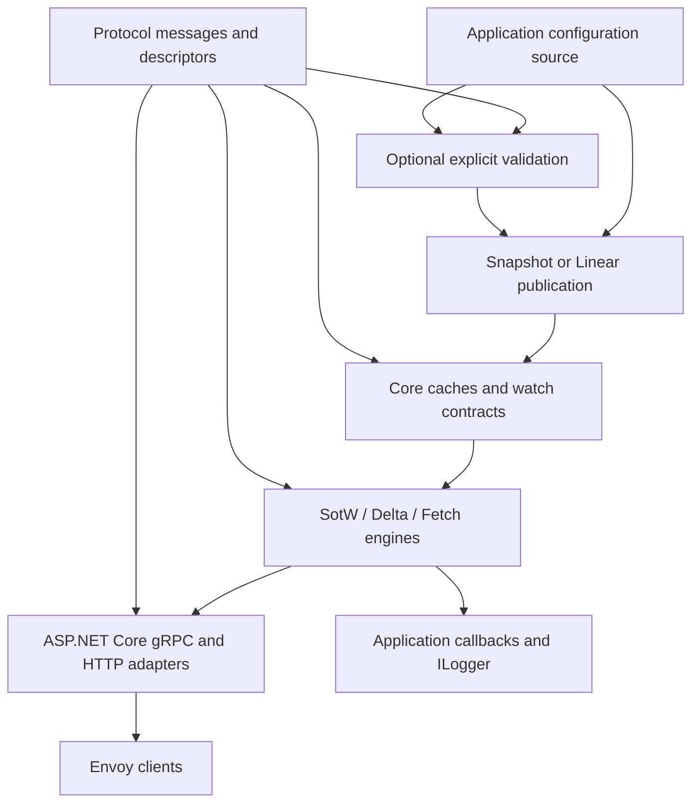
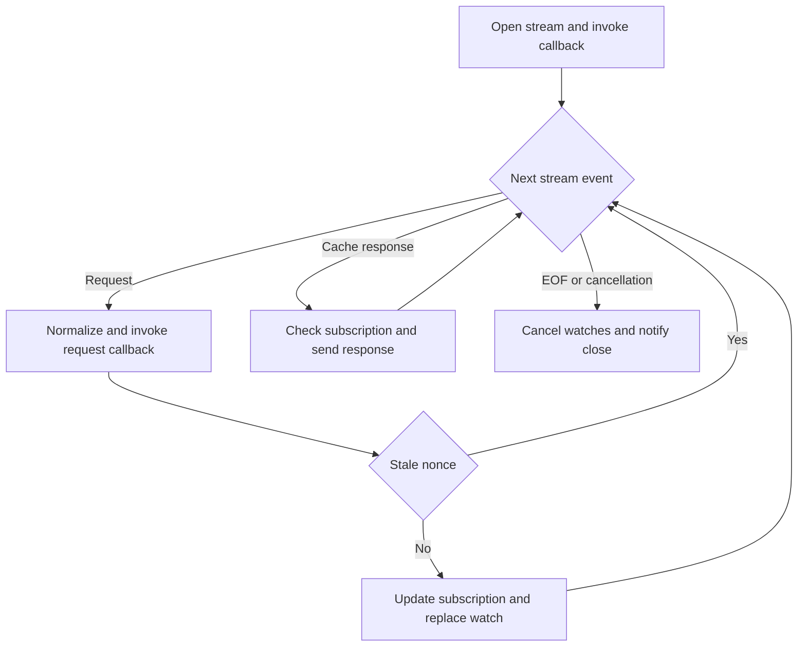

# Detailed architecture

Reviewed **26 October 2026**. Status: runtime design with implemented resource/cache/SotW/hosting sections; [T11 evidence](../plan/T11-ASP-NET-HOST.md) records current verification, while later features remain proposals. [T01 source provenance](../../schemas/PROVENANCE.md) records the source baseline. This document uses the Go behavior pin and the separate Envoy schema pin in [upstream-baseline.json](../../upstream-baseline.json). Requirements, task IDs, and verification IDs are defined in [traceability](../plan/TRACEABILITY.md) and the [implementation plan](../plan/IMPLEMENTATION-PLAN.md).

## 1. Purpose and compatibility contract

Provide an independent .NET library that applications embed to deliver caller-supplied Envoy configuration. Match observable behavior of the maintained v3 **root Go library**: caches, discovery servers, fetch transports, extension points, helpers, and the small SotW ADS client. Reproduce protocol outcomes and relevant defaults while using ordinary .NET asynchronous APIs.

**User-required scope ceiling: feature availability stops at Go parity.** The scope includes root-library v3 behavior and optional validation of the selected upstream schema constraints. Start from Go control flow and data ownership. Add .NET-specific machinery only when required for equivalent behavior or platform integration. New features and deliberate behavior changes require a separate scope decision.

The library does not translate a database or service catalog into Envoy configuration. Applications own configuration generation, authorization, durable storage, leader selection, and deployment. The built-in caches are process-local. A restarted host reconstructs them from the application's source; client initial versions and resubscription participate in convergence.

Four compatibility axes are published separately:

| Axis | Recorded evidence |
|---|---|
| Go behavior | Exact commit and in-scope surface from the [parity matrix](../plan/PARITY-MATRIX.md) |
| Schema support | Exact Envoy/import/ratelimit revisions, binding toolchain, selected input catalog, descriptor fingerprints |
| Schema validation | Original PGV rule inventory, evaluator/derived-metadata pins, per-rule coverage and GV evidence |
| Envoy interoperability | Released proxy versions and immutable image digests exercised by integration scenarios |

Preview includes SnapshotCache, SotW services/ADS, and a minimal host/example. Version 1.0 completes the root-library matrix. Original validation annotations are required from the first binding release; T03 establishes validation feasibility before binding freeze. T26/GV completes the optional validation package separately from preview and root-runtime gates. Matcher evaluation and full legacy/contrib catalogs remain deferred.

SotW means **state of the world**: a response describes the subscribed state for a resource type under that type's rules. Delta sends changed resources with per-resource versions and explicit removals. ADS multiplexes resource types over one stream; it is available independently with SotW or Delta. ADS does not create a transaction across resource types.

## 2. Packages and dependencies



| Package | Owns | Must not own |
|---|---|---|
| `Envoy.ControlPlane.Protocol` | One authoritative set of generated messages, descriptors, gRPC client/server contracts; required annotation definitions | Cache state, CEL evaluator, ASP.NET host policy |
| `Envoy.ControlPlane` | Resource catalog, snapshots, caches, watches, subscriptions, protocol engines, callbacks, fetch logic, conversion helpers, ADS client wrapper | Kestrel startup, HTTP routing, storage, process-wide mutable registries |
| `Envoy.ControlPlane.AspNetCore` | Concrete generated service adapters, DI registration, endpoint mapping, HTTP/JSON gateway | Independent protocol state machines |
| `Envoy.ControlPlane.Validation` | Explicit schema validation, structured outcomes, isolated evaluator integration | Duplicate Envoy message types, cache publication policy, stream state |

The root release uses Protocol, Core, and ASP.NET Core packages. The optional validation package references the authoritative Protocol types and owns its evaluator dependency. Its final name/provider follow T03. Core and ASP.NET Core remain independent of it; no validator interface or validated-publication decorator is added to Core.

Core targets .NET 10 provisionally. Protocol may use a wider compatible target after the package-consumption proof. Pin actual package/compiler versions during T02/T04; no floating dependencies. Core uses Google.Protobuf contracts, the chosen gRPC abstractions, logging abstractions, and `TimeProvider`. The client accepts an application-owned call invoker; it does not force an HTTP channel implementation on cache-only applications.

The T04 package/build layout exists; the resource, cache, server and hosting feature folders below remain planned. See [T04 build evidence](../plan/T04-BUILD-FOUNDATION.md):

```text
src/Envoy.ControlPlane.Protocol/          generated binding facade or owned outputs
src/Envoy.ControlPlane/                  Resources, Cache, Server, Client, Conversion
src/Envoy.ControlPlane.AspNetCore/       Services, Http, DependencyInjection
src/Envoy.ControlPlane.Validation/       optional validator; final provider/name after T03
tests/                                  unit, differential, transport, Envoy, package tests
examples/MinimalControlPlane/            runnable host and Envoy bootstrap
schemas/                                input manifests, lock data, controlled overlays
tools/                                  project-based generation and verification commands
scripts/                                retained historical provider research
Directory.Build.props                   shared build policy
Directory.Packages.props                central package versions
Envoy.ControlPlane.slnx                 maintained build/test project graph
docs/                                   design, usage, compatibility and evidence
```

## 3. Protocol catalog and ownership

T02 proposes one provider: an existing generated SDK only if its exact schema content, required service surface, restore, packaging, and descriptor ownership can be demonstrated; otherwise use repository-owned pinned generation. T03 evaluates validation metadata and a representative runtime slice before G1 freezes the choice. Consumers install built packages. Required contracts include server bases, client contracts, and ratelimit configuration discovery.

Select a standard Envoy input catalog that includes usable common extensions. Starting only from discovery request imports omits messages carried inside `Any`, including HCM/router/TLS configuration. Record the full input list, transitive dependency revisions, exclusions, licensing notices, tool versions, and output hashes. Resolve the original ratelimit schema source independently of `envoy/COMMIT`. Active extension dependencies may have version names other than v3; do not filter by directory spelling alone.

`IMessage` resources and `Any` extension payloads remain supported. Use the protobuf runtime's descriptor/type-registration facilities for JSON handling; a separate registry framework is not required. Keep one owner for each protobuf full name. Binary paths preserve unknown fields using the protobuf runtime; JSON conversion may reject unresolved `Any` descriptors and must not silently replace unknown payloads with empty messages.

T02 preserves original upstream validation annotations and required option definitions, owned once with the other descriptors, from the first binding release. T03 inventories the selected catalog and proves metadata access, single-owner integration, and representative valid/invalid outcomes before G1. A controlled PGV-to-Protovalidate overlay is permitted for the proof, with every derived option recorded and wire/message/service identity preserved. It must not create a second Envoy message assembly. Full rule conformance remains T26/GV; see the [validation plan](VALIDATION.md).

## 4. Proposed contracts

The snapshot contract is implemented by T05; watcher/subscription/response contracts and one-shot completion are implemented by T06. Node hashing is implemented by T07; Fetch remains a sketch for later tasks. See [T05 evidence](../plan/T05-RESOURCES-AND-SNAPSHOTS.md) and [T06 evidence](../plan/T06-WATCHES.md) for the implemented surface. Actual generated service signatures come from the selected bindings.

```csharp
public interface INodeHasher { string Hash(Node? node); }

public interface IResourceSnapshot
{
    string GetVersion(string typeUrl);
    IReadOnlyDictionary<string, ResourceEntry>? GetResourcesAndTtl(string typeUrl);
    IReadOnlyDictionary<string, IMessage?>? GetResources(string typeUrl);
    void ConstructVersionMap();
    IReadOnlyDictionary<string, string>? GetVersionMap(string typeUrl);
}

public interface IConfigWatcher
{
    IDisposable CreateWatch(DiscoveryRequest request, ISubscription subscription,
        ChannelWriter<ISotwResponse> responses);
    IWatch<IDeltaResponse> CreateDeltaWatch(DeltaDiscoveryRequest request, ISubscription subscription);
}

public interface IWatch<T> : IDisposable
{
    Task<T> Completion { get; }
}

public interface IConfigFetcher
{
    ValueTask<FetchResult> FetchAsync(DiscoveryRequest request, CancellationToken cancellationToken);
}
```

`ResourceEntry` retains a resource message and optional TTL. `ResourceCatalog.GetName` derives the indexing name from the message; applications can implement `INamedResource` for custom naming. `ISubscription` describes the exact names, prefixes, wildcard state, and returned metadata needed by the cache. Its collections remain stable for the watch lifetime; a separate immutable-view framework is not required. The stream owns subscription updates; cancel or complete its current watch before mutating the `SotwSubscription`. A cache retains a stable view only for its watch lifetime. T08 copies read-only returned-version metadata into owned mutable bookkeeping; protobuf messages are not cloned by this operation. Response envelopes retain the originating request, context, version, returned metadata, and materialization behavior needed for upstream custom-cache parity. `ResponseContext` carries the creation cancellation token and optional caller state for callback correlation, adapting Go context without depending on ASP.NET or ambient state. Custom response interfaces preserve lazy materialization and failure propagation. Keep stream-specific nonce mutation away from data shared by multiple streams.

T10 makes SotW producer delivery channel-based: ordinary streams supply individual bounded channels, and ordered ADS supplies one shared bounded FIFO. The producer writes directly to its destination to establish publication order. A cancellation registration that owns pending asynchronous writes implements `IAsyncDisposable`; the stream awaits disposal before changing subscription state. Releasing one registration must not complete a shared writer. A two-argument extension retains await-one convenience through `IWatch<ISotwResponse>` over an individual channel. Its task completion can resume after enqueueing; it does not schedule stream responses. Delta retains its task-based contract until T14.

`Watch<T>` remains a standalone one-shot primitive with asynchronous continuations and idempotent synchronous disposal. Consumers of the task adapter use a disposal scope around `Completion.WaitAsync(cancellationToken)`; canceling that wait alone does not dispose the registration. Cache delivery must not invoke network I/O inside publication locks, and an immediate result must remain valid before the stream begins reading it. These API choices prioritize behavioral parity using standard .NET coordination rather than translating Go's synchronization structure.

Use `FetchResult` with `Response` and `NotModified` cases. Model unsupported fetch, missing classifier, missing snapshot, materialization failure, and callback rejection separately; preserve transport mappings rather than flattening every failure into `InvalidArgument`. Exceptions may expose library error types internally; host adapters own transport translation.

Callbacks cover the same open, request, response, close, and fetch hooks as Go, in the same mode-specific order. Await asynchronous hooks in the processing loop; open/request hooks can reject. T09 must define one exception-to-call-failure and cleanup mapping for .NET, since Go response/close hooks do not return errors. Do not add hook-policy options, retry stages, or a middleware pipeline. Preserve effective request/response mutation where the upstream callback permits it.

## 5. Resource ownership and versioning

Follow Go's stable-resource convention: callers must not mutate a message while it is published or retained by a watch. Publish replacement messages and versions when configuration changes. The library owns its bookkeeping and documents message lifetimes, but does not add mandatory clone-on-publication, clone-on-read, or an ownership-transfer API. Copy a request, response, or collection only where equivalent Go behavior or actual concurrent use requires isolation. Caching bytes/hashes relies on this documented lifetime contract.

Preserve upstream lazy materialization/version computation where used. Do not cache a stream nonce in shared serialized data. Per-type snapshot versions are caller-supplied opaque strings. LinearCache maintains its own version counter with an optional instance prefix. Default Go resource hashes use SHA256 over deterministic protobuf bytes; cross-language equality is unproven. Test semantic equality and version relationships and report literal-hash limitations. Do not introduce a public pluggable version-strategy API without an upstream equivalent or a separately approved need.

`Snapshot.EnsureConsistent()` remains opt-in and checks the source's EDS/RDS reference-set conditions. A partial snapshot can be valid for a consumer. `SetSnapshot` does not automatically call consistency or a validator. Reference extraction, semantic protobuf validation, xDS ACK/NACK, and Envoy runtime acceptance are separate checks.

## 6. Cache algorithms

### 6.1 SnapshotCache

State is keyed by `INodeHasher`; default behavior is `Node.Id`, with empty string for absent node. Each node entry holds a stable snapshot reference, SotW and Delta watch indexes, and source-equivalent status. Start with the cache-level synchronization used by Go; per-node locks and additional lock layers are not prescribed. Clear removes snapshot and indexed status; it neither completes/cancels old watches nor synthesizes deletion responses. A previously obtained status handle retains its old state. T07 implements this SotW cache; Delta delivery and heartbeats remain T14/T17.

Publication algorithm:

1. The application constructs a snapshot and keeps its messages stable while published.
2. Under cache synchronization, replace the snapshot reference and evaluate eligible watches, matching Go's registration/publication behavior.
3. Begin channel writes in source resource-priority order when cache ADS mode is enabled. Release cache synchronization before awaiting buffer space. Serialize asynchronous publications so later publications cannot overtake an earlier blocked one; honor cancellation while waiting before installation.
4. `SetSnapshotAsync` returns after eligible enqueue operations settle, without waiting for Envoy to receive, ACK, or apply the change. The snapshot can remain installed after publication cancellation, matching the source behavior.

Watch registration and snapshot lookup occur under the same cache synchronization so an update between lookup and registration cannot be lost. Response eligibility includes snapshot version, resource selection, subscriptions, and ADS readiness. If no snapshot exists, register a pending watch. Preserve the source's special ADS coverage edge: when a non-wildcard request omits a name present in the snapshot, creation returns neither a response nor a registered watch. An extra requested name absent from the snapshot is allowed if all snapshot resources are covered. T07 represents the untracked case as a pending cancelable task; its Go comparison fixtures establish the direction of the check.

Default snapshots support the resource families mapped by `GetResponseType`; arbitrary type constants alone do not add snapshot storage slots. Custom resource types use custom snapshot/cache implementations or LinearCache/MuxCache. Generic ADS dispatch remains type-URL based.

### 6.2 LinearCache

Owns a single type URL and shared resource collection, with exact/prefix/wildcard watch indexes and a version prefix/counter. Implement the source's initial resources, update, delete, bulk change, and replace-all operations under equivalent cache synchronization. Do not add validation or transactional batch-publication semantics. Define duplicate/missing-name errors and no-op version behavior from the source fixtures. Track per-resource hashes for Delta and collection versions for SotW. `Fetch` returns the source's unsupported-operation result.

### 6.3 MuxCache

Routes SotW and Delta through separately configurable classification functions and delegates fetch using the source's selection contract. Classifier output selects a registered child cache; missing keys are errors. Child caches remain independently owned unless explicitly registered with ownership transfer. The mux must not hide LinearCache's unsupported fetch or invent an aggregate snapshot transaction.

### 6.4 Status

Expose the source's node identity, SotW/Delta watch counts, last respective request times, and node lists. Protect bookkeeping reads as Go does; status does not require a general deep-copy API. A controllable clock supports the existing timestamp/heartbeat behavior. Counters must reflect register/complete/cancel/clear paths, including immediate responses and the special ADS no-registration case. Status is not a durable record of client acceptance.

## 7. Watch delivery and concurrency

Use one processing loop per stream, one current watch record per type URL, and one serialized send path, following Go. Receive requests concurrently if needed so the loop can await requests and cache responses. Choose the smallest task/channel arrangement that supports those events and the source's backpressure. A dedicated writer service, bounded-mailbox framework, and generation-ID layer are not prerequisites.

Ownership rules:

| State | Owner / synchronization |
|---|---|
| Snapshot/Linear resources, watch indexes and status | Cache synchronization matching the Go operations |
| Stream node, nonce sequence, per-type subscriptions and current watches | Stream processing loop |
| Published resource messages and lazy materialization | Stable-resource lifetime contract |
| Callback invocation and response send | Processing loop, outside cache synchronization |

Preserve watch cancellation and the source's subscription checks so superseded SotW responses are not sent after unsubscribe. Add an internal identity/generation check only if the chosen delivery mechanism can leave obsolete completions queued; prove the need with a source-matched race case. T14 separately preserves Delta's pending-response draining. These rules do not require a generalized state-machine or dispatcher framework.

Backpressure follows the upstream watch/stream behavior. Cache code must not await socket writes under its locks. The core adds no configurable queue limits, active-watch quotas, eviction policy, or resource-exhaustion policy. Normal ASP.NET Core transport settings remain application hosting choices. Test cancellation, immediate completion, and blocked writers against the Go behavior rather than promising a new throughput or fairness guarantee.

## 8. SotW state machine



This describes Go's event loop, not an enum-based state machine. Errors or callback rejection at any processing step close the stream through the same cleanup path. Each type record stores its subscription, watch/cancel handle, and response nonce. Completing one type's one-shot cache watch does not put the whole ADS stream into an `AwaitRequest` state; other types continue through the loop.

For each request: restore the last node when omitted; preserve an explicitly supplied later node as Go does. Fill an absent per-type type URL; reject absent ADS type URL. Invoke the request callback at the source-equivalent point. If the current watch has a nonempty response nonce that differs from the request nonce, ignore the request without replacing that watch. Otherwise cancel the old watch before updating the subscription, register a new one with stable subscription metadata, and process a possible immediate result. Match Go's current-watch nonce lifetime rather than introducing an independent ACK ledger.

Sending checks that resources still match the current subscription, materializes a fresh response, assigns a stream-unique nonce, records returned-resource metadata at the source-equivalent send stage, invokes the response callback, and writes once. Failed writes close the stream. ACK/NACK details are visible to callbacks; do not invent an automatic rollback of a published snapshot. Snapshot versions and request versions control re-response; a NACK does not automatically blacklist a version in this library.

SotW resource selection is type-specific: clusters/listeners require the source's full-state behavior; do not apply one generic named-resource filter to every family. Legacy empty subscription initially means wildcard by default. After explicit SotW subscriptions, empty does not restore legacy wildcard. Exact names, `*`, and collection prefixes such as `collection/*` need distinct state.

## 9. ADS coordination

The unordered default shares the SotW engine with independent type watches. `OrderedAds=true` selects the source's ordered SotW ADS behavior: drain pending responses for other types when updating a type and preserve the source resource-priority policy and readiness conditions. Ordering does not promise that clients apply all types atomically. SnapshotCache's ADS readiness setting and the stream's ordering option are separate choices; configure and test both.

For ordered SotW ADS, follow Go's separate processing path: drain the shared response channel on watch replacement, retain other-type progress, discard superseded current-type results as the source does, and recheck subscriptions before sending. An internal identity check is an option only if the .NET delivery mechanism needs it. A nonce is unique across the stream; response association is maintained per type. Keep upstream custom-type handling.

Do not automatically apply this option to Delta: the reviewed source's `Ordered` selection occurs in the SotW path. Delta ADS uses its own multiplexed response processing.

## 10. Delta state machine

Per-type state contains subscription exact names/prefixes/wildcard, returned resource versions, first-request initialization state, current watch generation, and last sent nonce for observation. `InitialResourceVersions` seeds the first request of each type, not every subsequent request on that stream.

Process pending completed Delta responses before a new request, matching the Go engine. Its request callback runs before the source's node/type completion step; preserve that observable distinction from SotW. For a new type construct subscription state; otherwise cancel its previous watch before applying additions/removals. Pass the resulting immutable view into the cache.

Responses contain changed resources with versions, removed names, and a system version. A wildcard initial request may require an empty response. Update returned-resource tracking when a response is sent, as the source does. **The reviewed Delta loop does not implement SotW's stale-nonce rejection or a separate ACK-committed version ledger.** Record NACK information through callbacks and test the source behavior; do not share an imagined ACK state machine between modes. A spec/source discrepancy becomes a documented decision with fixtures, rather than a silent correction.

Subscription updates process subscribe then unsubscribe entries. Preserve the wildcard case where unsubscribing a previously explicit name forces an update/removal report even while wildcard remains active. Prefix subscription behavior and unsubscribe/re-subscribe without a resource change need dedicated cases. Reconnect creates a fresh stream and uses the client's provided initial versions.

## 11. TTL and heartbeats

Represent TTL independently from the resource payload. Materialize the correct xDS resource wrapper, optional duration, version, and payload omission for heartbeat responses. TTL is a proxy expiry instruction; the cache must not delete resources automatically merely because a duration elapsed.

The reviewed SnapshotCache periodic heartbeat loop scans **SotW watches only**. It sends TTL-bearing resources using the current snapshot version, omits the normal resource payload in heartbeat mode, preserves returned-resource metadata, and consumes the one-shot watch; the next client request creates another. Preserve its exact/prefix selection behavior using fixtures, rather than assuming every selection path is identical to normal responses. Delta resource TTL encoding is in scope; an additional automatic Delta heartbeat scheduler is not source parity.

Use an injected `TimeProvider` and a cache-owned timer. Only start it when heartbeat mode is enabled with a valid interval. Disposal cancels the timer and pending owned work, is idempotent, and prevents publication after shutdown. Tests advance a fake clock and explicitly demonstrate proxy expiry and refresh with a real Envoy.

## 12. Transports and error semantics

Generate thin adapters that map each supported method to its engine and implied type URL. The exact [RPC matrix](../plan/PARITY-MATRIX.md) is authoritative: eight standard resource families expose SotW/Delta/unary/HTTP; ADS exposes both streams; VHDS/LEDS are Delta only; rate-limit configuration has SotW and unary only, with no dedicated Delta or HTTP route. Do not register runtime implementations for unrelated generated services.

Unary fetch runs request callback, cache fetch, materialization, response callback, then transport return. Preserve the source's nil-request and cache-error semantics through fixture-based mapping. `NotModified` is a distinct cache outcome, not an empty discovery response. Linear/Mux limitations remain visible.

The HTTP gateway delegates to this same fetch engine. Use protobuf JSON with proto field names for output, registered `Any` descriptors, and the source parser's acceptance/rejection behavior. Verify Google.Protobuf JSON options against Go protojson; configure or adapt rather than assume equivalence. Route normalization uses source `path.Clean` semantics where feasible. The Go handler does not enforce an HTTP verb; any ASP.NET verb restrictions must be documented departures rather than accidental 405s.

| Condition | HTTP outcome |
|---|---|
| Unknown discovery path | 404 |
| Missing/unreadable body or invalid protobuf JSON | 400 |
| Unchanged cache version | 304, no response body |
| Other fetch/materialization/JSON failure | 500 |
| Successful fetch | 200, protobuf JSON |

Routes: `/v3/discovery:endpoints`, `:clusters`, `:listeners`, `:routes`, `:scoped-routes`, `:secrets`, `:runtime`, and `:extension_configs` (all share the `/v3/discovery` prefix). The route overrides a body-supplied type URL. Content type, body size, deadlines, and framework routing differences are explicit host settings with transport cases. gRPC cancellation uses the call cancellation token; no response can be written after stream termination.

## 13. ASP.NET Core integration and lifecycle

T11 implements parameterless `AddEnvoyControlPlane()` using application-registered singleton cache, optional callbacks and initialized SotW options. `MapEnvoyControlPlane()` returns a standard route group for the nine preview SotW services and application endpoint conventions. HTTP/Fetch mapping and JSON descriptor registry configuration remain T18. Runtime caches are shared singletons unless the application deliberately supplies another lifetime. Stream sessions are per-call objects. Use ordinary ASP.NET Core dependency injection and call lifetimes; do not add a callback-factory framework.

Startup builds the descriptor registry, validates options, and starts explicitly enabled timers. Shutdown stops accepting calls, cancels sessions through a linked host token, cancels/disposes all watches, awaits reader/event-loop completion, and disposes owned timers/resources. Cleanup runs on open-hook rejection, EOF, reader failure, writer failure, callback failure, and host stop. Close notification occurs once after watch cleanup even if open was rejected, matching source lifecycle intent.

Authentication/TLS/authorization use ASP.NET Core facilities. Node ID is an application routing key, not proof of identity. Show application-owned authorization through an existing request callback. Transport limits and exception exposure use host configuration; the library adds no separate policy subsystem. Map the Go logging surface to `ILogger`, keeping resource payloads out of default messages. Telemetry remains an application use of the existing callbacks.

## 14. ADS client and helper surface

The client wrapper is a focused SotW ADS client for one node/type URL, using a caller-owned call invoker. Initialization opens the stream and sends the initial request. Receive stores the latest received response and returns resources. ACK records the latest response as accepted and sends its version/nonce. NACK retains the last accepted version, uses the latest received nonce, and includes the supplied error message. Serialize client operations and define concurrent-call rejection or locking explicitly.

Connection-error classification covers the source's EOF/Unavailable/Canceled categories. The wrapper does not invent a reconnect/backoff policy. Dispose its call/stream, never the application channel. Reinitialization and use-before-initialization have fixtures.

Resource helpers include name resolution, type URL constants, reference extraction (including HCM in Any), and well-known extension identifiers required by the mapped source. Conversion uses protobuf JSON rules for message/Struct round trips. Built-in resource catalogs and custom descriptor registration use one shared abstraction; avoid hardcoded assumptions in cache-independent helpers.

## 15. Optional schema validation

Optional validation is an approved compatibility surface for the selected schema catalog. The target is the pinned upstream rule semantics; Protovalidate remains a candidate implementation. Preserve original annotations and descriptors from the first binding release. A runtime does not execute PGV annotations merely because they are present.

T03 is a bounded binding-design prerequisite. Inventory upstream rules, evaluate .NET candidates, prove metadata access and a representative Go/.NET corpus, and resolve descriptor ownership before G1. Record feasibility limits explicitly. Do not freeze bindings that discard metadata needed for validation without an explicit scope decision.

T26 provides a separate explicitly invoked validation package. Report successful validation, constraint violations, unsupported metadata/rules, and evaluator faults distinctly. An unsupported constraint cannot count as success. GV covers the complete claimed catalog/rule set, applicable evaluator conformance, Go PGV comparison, binary/descriptor compatibility, and clean package consumption.

SetSnapshot and LinearCache publication retain Go behavior without automatic validation. No Core validator framework, publication decorator, or generic policy pipeline is added. Snapshot reference consistency and Envoy ACK/NACK acceptance remain separate checks. Exact Go method signatures, error text, and violation ordering are not promised by the semantic compatibility claim.

## 16. Verification, packaging, and upstream updates

Use named cases in [traceability](../plan/TRACEABILITY.md). The differential harness drives the pinned Go reference and .NET through equivalent scripted events and compares parsed resources, subscriptions, errors, callbacks, watch counts, and version/nonce relationships. Preserve stale relationships using consistent opaque-value mapping. Do not sort away protocol-required ordering or normalize away NACK/error differences. Use deterministic scheduling/barriers for races; a timeout is failure evidence, not proof of correct cleanup.

Run actual released Envoy images for initial bootstrap, update, NACK, reconnect/resubscribe, Delta removal, and TTL refresh/expiry. Inspect config dump and observable traffic/admin counters as well as control-plane logs. A successful TCP/gRPC connection alone is insufficient.

CI stages cover pinned generation/descriptor checks, compilation and unit cases, Go differential cases, transport/lifecycle cases, real Envoy, pack/clean-consumer tests, and a compatibility report. Choose test framework and platforms in T04; Linux runs Envoy containers, with Windows/macOS build and relevant host tests. Pin CI actions/toolchain and keep substantial logic in versioned scripts. Protocol package inputs and annotation/runtime choices must be reproducible in a clean environment.

Upstream update tooling records old/new behavior and schema pins, regenerates selected inputs, and inventories added/changed/removed validation rules. Compare original annotations and any derived overlay, coverage, and Go/.NET outcomes before accepting a validation-package update. Changed or unsupported unevaluated constraints block the validation claim for that candidate. Root-only updates retain annotations and publish the gap explicitly; they cannot imply validation coverage. Keep historical evidence tied to its immutable pin.

## 17. Risks and unresolved decisions

| Risk / decision | Required closure |
|---|---|
| SDK cannot prove exact schema/server-contract coverage | T02 selects owned generation; G1 blocks public API freeze |
| Ratelimit descriptor filename differs from its source import root | T01 identifies matching sources/definitions; T02 resolves provider filename/ownership before G1 |
| Duplicate Envoy/annotation types across runtime dependencies | T02 clean-consumer proof and dependency graph; one owner |
| Binding choice blocks validation | T03 metadata/descriptor and bounded equivalence proof before G1; full conformance remains GV |
| Migration or schema update changes constraints | T24/T26 rule diff and coverage report; unsupported rules fail visibly and block affected validation claims |
| Source behavior differs from protocol expectation | T21 creates divergence record and explicit decision; preserve baseline until approved change |
| Per-stream serialization or watch races lose progress | T06/T22 adversarial scheduling, watch/status leak checks |
| Generated catalog too large or contains unsupported language inputs | T02 explicit manifest/exclusions and consumer example; revisit coverage before release claim |
| Caller mutates a resource while published | T05 documents and exercises stable-resource usage; no mandatory deep-copy layer |
| .NET target, branding, matcher/contrib needed by a named consumer | Record requirement before relevant API/package publication; proposed defaults stand meanwhile |

## 18. Source anchors

All source anchors refer to Go commit `67c5345367582741334e34ffc66a561b0ce32946`; paths are in the separate upstream repository.

- [Cache contracts](../../../go-control-plane/pkg/cache/v3/cache.go), [snapshot](../../../go-control-plane/pkg/cache/v3/snapshot.go), [SnapshotCache and heartbeats](../../../go-control-plane/pkg/cache/v3/simple.go), [cached resources](../../../go-control-plane/pkg/cache/v3/cached_resource.go).
- [LinearCache](../../../go-control-plane/pkg/cache/v3/linear.go), [MuxCache](../../../go-control-plane/pkg/cache/v3/mux.go), [resource selection](../../../go-control-plane/pkg/cache/v3/resource.go), [status](../../../go-control-plane/pkg/cache/v3/status.go).
- [SotW default path](../../../go-control-plane/pkg/server/sotw/v3/xds.go), [SotW ordered ADS](../../../go-control-plane/pkg/server/sotw/v3/ads.go), [send path](../../../go-control-plane/pkg/server/sotw/v3/server.go), [Delta](../../../go-control-plane/pkg/server/delta/v3/server.go), [subscriptions](../../../go-control-plane/pkg/server/stream/v3/subscription.go), [options](../../../go-control-plane/pkg/server/config/config.go).
- [Service adapters](../../../go-control-plane/pkg/server/v3/server.go), [HTTP gateway](../../../go-control-plane/pkg/server/v3/gateway.go), [fetch engine](../../../go-control-plane/pkg/server/rest/v3/server.go), [ADS client](../../../go-control-plane/pkg/client/sotw/v3/client.go).
- [xDS specification](https://www.envoyproxy.io/docs/envoy/latest/api-docs/xds_protocol.html), [protobuf serialization limits](https://protobuf.dev/programming-guides/serialization-not-canonical/), [validation sources and assessment](VALIDATION.md).
