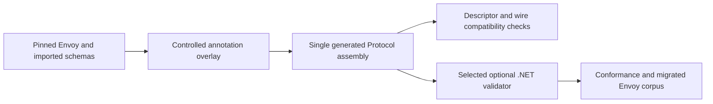

# Protovalidate integration design

Reviewed **24 October 2026**, following the user's identification of Protovalidate as PGV's successor. Status: architecture and proof plan. No candidate runtime has been restored, executed, or selected in this workspace.

## 1. What changes in the proposal

Use **Protovalidate as the preferred optional validation direction**. Remove the implication that the absence of a C# PGV generator means no practical .NET validation path exists. Keep the distinction between generating protobuf classes, validating configuration before publication, and receiving an Envoy xDS ACK/NACK.

Protovalidate evaluates standard constraints and CEL rules at runtime. Its upstream lists Go, Java, Python, C++, and JS/TS implementations; C# is not listed as a first-party runtime in the reviewed overview. [Protovalidate](https://github.com/bufbuild/protovalidate)

Community candidates exist:

| Candidate | Documented package / capability | Required investigation |
|---|---|---|
| [telus-labs/protovalidate-net](https://github.com/telus-labs/protovalidate-net) | `ProtoValidate`; .NET validation using descriptors and CEL | Exact release, schema-option ownership, supported constraints/CEL, failure behavior, licensing, support activity |
| [bsidio/celly](https://github.com/bsidio/celly) | `Celly.Protovalidate`; native C# CEL and Protovalidate support | Same checks, plus independently reproduce relevant conformance claims |

Repository documentation establishes availability; it does not establish suitability for this Envoy catalog. Do not select a provider by a README's conformance count alone. Compare pinned versions in T03, and install exactly one provider in T26 after evidence supports it.

## 2. Existing PGV metadata is the integration problem

Envoy bindings at the reviewed pin contain PGV rules. A Protovalidate runtime alone does not make those rules executable. The migration guide describes adding `buf.validate` annotations alongside PGV before removing legacy annotations; it also identifies changed constraint semantics and unsupported rules. Validation uses reflection rather than a validation protoc plugin. [Official migration guide](https://protovalidate.com/migration-guides/migrate-from-protoc-gen-validate/)

Proposed proof pipeline:



The overlay is repository-owned build input derived from pinned upstream sources, not an edit to the separate Go reference checkout. Pin the migration tool revision and its annotation dependencies. Keep PGV metadata during initial evaluation. Preserve protobuf full names, field numbers/types, oneofs, defaults, packing, JSON names, services, and custom options other than declared annotation additions. Compare normalized descriptors before/after, and binary round trips using Go and C# fixtures. Descriptor bytes are expected to differ where options are added; do not assert byte-identical descriptors.

Build a rule inventory over the selected catalog. Explicitly review presence/required semantics, ignore-empty/skip behavior, oneofs, nested messages, map constraints including sparse-map differences, numeric edge cases, regex/Unicode, timestamps/durations, enums, and `Any`. Record unsupported transformations with schema/field/rule locations. No unknown rule may be silently marked supported.

An annotation assembly may already be distributed by a runtime. T03 must prove extension-option registration and CLR type ownership with the chosen binding provider. Prefer shared annotation definitions owned once, with the evaluator only in the optional adapter. If that cannot be made compatible, evaluate an external descriptor/rule overlay only through a concrete proof; do not assume the runtime accepts it.

## 3. Provider-neutral boundary

Proposed Core contract, to be frozen after G1:

```csharp
public interface IResourceValidator
{
    ValueTask<ResourceValidationResult> ValidateAsync(
        IMessage resource, CancellationToken cancellationToken);
}
```

Result carries validity and structured violations: resource type/name, field path, stable rule identifier when available, and diagnostic message. Descriptor/CEL compilation failures, unsupported rules, cancellation, and unexpected evaluator faults are failures distinct from a valid result with violations. Avoid promising identical violation ordering or text across providers; define deterministic adapter ordering if consumers need it. Cap collected violations and document truncation explicitly.

`ValidatedSnapshotPublisher` is a separate opt-in decorator around publication:

1. Build the candidate using the same ownership/copy rules as snapshots.
2. Validate every candidate resource outside cache locks. Enforce explicit metadata coverage for enabled Envoy validation; an unannotated descriptor must not appear to have proved Envoy rule equivalence.
3. On any violation or validator failure, return diagnostics and retain the previous snapshot. Do not partially publish a resource collection.
4. Optionally run the separate source-matching consistency check if the application selected it.
5. Publish the validated immutable candidate once. Publication success still does not imply Envoy acceptance.

Raw `SetSnapshot` remains available and does not validate by default. Per-resource LinearCache validation uses an analogous decorator, with a batch validated before installing it; it cannot validate arbitrary global references without an application policy. Custom caches can call the validator explicitly.

## 4. Runtime lifecycle and operational behavior

Preload/compile selected descriptors at startup where the candidate supports it. A rule-compilation failure should fail explicit validator initialization rather than first appear during a cache lock or a proxy response. Cache compiled programs with documented bounds. Establish whether one validator is safe for concurrent use or needs bounded instances; do not infer thread safety solely from a provider claim.

Cancellation must be honored before and between resource validations. If a provider cannot interrupt a synchronous CEL evaluation, document that limit and establish supported expression/input bounds before enabling untrusted custom rules. Do not claim hard execution deadlines from a cancellation token alone. NativeAOT/trimming are separate compatibility experiments, not implied support from ordinary .NET execution.

No resource or Secret payload is written to normal diagnostics. Field/rule paths are sufficient for default logs. Preserve full internal exceptions for application-controlled diagnostics without forcing them into HTTP/gRPC error text.

## 5. Proof and release criteria

T03 is mandatory early design work; T26 is the optional implementation work. Required evidence for **GV**, the validation release gate:

- Pinned provider/package, migration tool, annotation inputs, and conformance corpus revision, with reproducible restore/build.
- A clean consumer using Protocol, Core, and the adapter with no duplicate message or annotation definitions.
- Normalized descriptor and binary-compatibility checks for migrated inputs.
- Official conformance corpus execution where supported, with exact pass/fail/skip details and explained exclusions.
- An Envoy-specific corpus comparing original Go PGV outcomes and migrated .NET outcomes for supported rules. Differences are classified; a Protovalidate conformance pass alone does not prove PGV equivalence.
- Nested/repeated/map/oneof/Any/presence cases; malformed or unsupported CEL; cache/thread reuse; cancellation; diagnostic limits; publication atomicity; disabled-validation behavior.
- Dependency inspection showing the CEL evaluator is absent from a Core-only consumer's runtime graph.

If metadata migration or the runtime fails this gate, retain the Core release scope and report the adapter as experimental or unavailable for Envoy validation. Custom messages already using supported `buf.validate` rules may have a narrower separately evidenced claim. Do not describe missing validation as successful validation.

## 6. Effort and decision consequences

The root-library estimate includes a bounded T03 provider/metadata assessment inside the initial proof checkpoint. Full corpus migration, provider remediation, and the T26 adapter are **additional optional work** and are not included in the 6–10 engineer-week root estimate. Estimate that work only after the rule inventory and candidate proof; unsupported CEL or schema metadata can materially change it.

PGV `Validate`/`ValidateAll` method-shaped API parity would require a further explicit commitment. The useful proposed feature is opt-in semantic validation with documented coverage. The selected adapter should expose that contract without claiming affiliation with Buf or Envoy.

Related: [ADR10](DECISIONS.md), [architecture](ARCHITECTURE.md), [tasks T03/T26](../plan/IMPLEMENTATION-PLAN.md), [requirements R23/R24 and cases V34–V36](../plan/TRACEABILITY.md).
