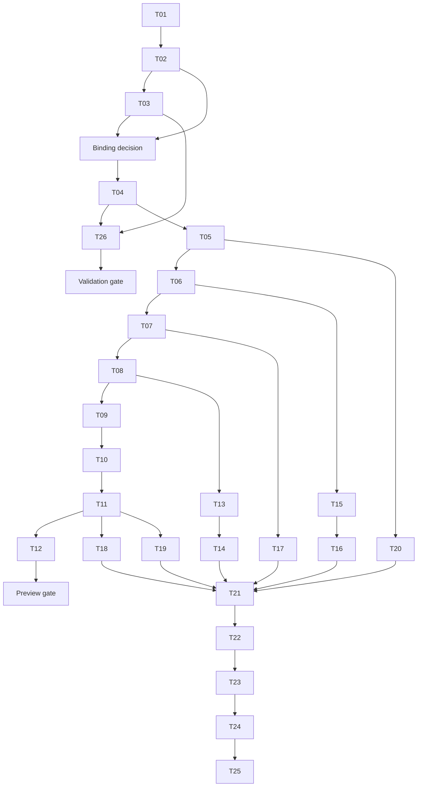

# Implementation plan: tasks and subtasks

Reviewed **26 October 2026**. T01/T02 merged in PRs #33/#34, with [provenance evidence](../../schemas/PROVENANCE.md) and [binding evidence](../../schemas/BINDINGS.md). T03 has a user-selected source arrangement and [bounded local feasibility evidence](../../schemas/VALIDATION.md), merged in PR #35 for the bounded binding decision. T01 brought the test framework/runner and tooling CI forward from T04; T04 merged in PR #38 with the [build/package foundation](T04-BUILD-FOUNDATION.md). T05 merged in PR #39 with [resource/snapshot primitives](T05-RESOURCES-AND-SNAPSHOTS.md). T06 merged in PR #40 with [watch primitives and custom response contracts](T06-WATCHES.md). T07 merged in PR #41 with the [SotW SnapshotCache](T07-SNAPSHOT-CACHE.md). T08 implements [SotW subscription transitions](T08-SOTW-SUBSCRIPTIONS.md); T09 adds the [core SotW loop and callbacks](T09-SOTW-STREAM-ENGINE.md). T10 adds [channel-based ordered ADS](T10-ORDERED-ADS.md). T11 adds the [ASP.NET Core SotW host](T11-ASP-NET-HOST.md). Delta cache delivery remains **planned**. T26 delivers optional schema validation behind GV. T27/T28 remain **deferred** until a separate scope decision. T05 evidence covers resource primitives and snapshot behavior; it does not establish an operational control-plane server. This backlog implements the [architecture](../architecture/ARCHITECTURE.md) and [parity matrix](PARITY-MATRIX.md); [traceability](TRACEABILITY.md) defines requirements, cases, and gates.

## Execution rules

Each task below identifies dependencies, proposed outputs, numbered subtasks, and acceptance criteria. Output paths are future artifacts inside this .NET repository unless explicitly described as reference evidence. Do not edit the sibling Go checkout to make a differential case pass. Preserve source/spec divergences in a decision record tied to the baseline.

**Feature ceiling:** implement the selected Go root-library surface, its approved optional schema-validation constraints, and necessary .NET adaptations. Use idiomatic C# APIs and synchronization to preserve observable behavior; translating Go implementation structure is not a requirement. A task does not authorize extra options, frameworks, stronger ownership guarantees, or performance APIs. T03/T26 are active scope; T27/T28 remain deferred. Automatic validation-on-publication is excluded.

Task completion requires its acceptance criteria, relevant verification artifacts, and documentation updates. A test name alone does not count as a passing result. Record exact commands, tool versions, fixture versions, and outcome at implementation time. T01 selected xUnit/Microsoft Testing Platform for the initial CLI test project; T04 extends that established setup to the runtime projects.

## Milestones and sequencing

| Milestone | Required tasks | Gate / deliverable |
|---|---|---|
| M0 — establish provenance | T01 | G0; complete source/import inventory |
| M1 — close generation design | T02, T03 | G1; usable binding provider, preserved annotations, and bounded validation feasibility proof |
| M2 — useful preview | T04–T12, preview portions of T20–T24 | G2; SnapshotCache + SotW/ADS + real Envoy example |
| M3 — root-library scope | T13–T20 | G3; full service/cache/helper feature matrix |
| M4 — release evidence | T21–T25 | G4 then G5; differential, lifecycle, Envoy, package proof |
| Optional validation track | T26 after T03/T04 | GV before validation-package publication or validation-parity claims; full conformance does not block M2–M4 |
| Deferred scope; not a milestone | T27, T28 | Explicit scope decision before execution; extension gate |

T21's harness starts as soon as T02/T04 allow; T12 uses its SotW subset. T22–T24 similarly build incrementally, rather than waiting until feature completion to introduce evidence. Final task dependencies below describe completion prerequisites, not a prohibition on early harness/setup work.

The table and task dependency fields are authoritative; the diagram summarizes the main flow. Preview gate is required before a preview is published, but 1.0 engineering can continue before publication. Independent helper/Linear/client work can overlap after shared contracts stabilize; coordination must avoid competing edits to contract files.

## Epic A — provenance and binding proofs

### T01 — Lock the complete upstream input set

**Status:** Merged in PR #33. Source lock/catalog, rate-limit descriptor comparison, license inventory, C# retrieval/inspection app and automated V01 acceptance/rejection tests are complete. The original 17 CLI tests and full 523-schema inspection passed; T02 extends the CLI suite to 19 tests for source export. See [G0 evidence](../../schemas/PROVENANCE.md) and [test mapping](../../tests/README.md).

**Scope:** foundation / R01. **Depends on:** none. **Outputs:** `schemas/upstream.lock.json`, `schemas/catalog.json`, provenance report, updated baseline JSON if input data is added.

Subtasks:

- T01.1 Record reviewed Go and Envoy commits, module replacements, and exact source origins for imported schemas.
- T01.2 Trace ratelimit generated descriptors to original schema sources; pin revision and compare service/message definitions.
- T01.3 Inventory standard, legacy, contrib, validation annotation, and custom-extension inputs; classify inclusions/exclusions explicitly.
- T01.4 Record licenses/notices and checksums; document source retrieval without nesting repositories inside another repository's source tree.

**Acceptance:** V01 passes; every generation input has an immutable origin or a documented blocker. No floating source remains in the proposed release catalog. G0 blocks generation acceptance if ratelimit provenance is unresolved.

### T02 — Prove a candidate binding provider

**Scope:** foundation / R02, R04. **Depends on:** T01. **Outputs:** candidate provider decision, pinned toolchain/package lock, generation/restore script, original annotation/descriptor inventory, clean-consumer evidence. G1 freezes the choice after T03.

**Status:** Merged in PR #34. Buf CLI generates the full selected catalog from unchanged upstream schemas; Protocol targets net10.0 with centralized package management. The merged CI passed 24 offline tests, eight binding tests and eight clean-package consumer tests on Linux/macOS/Windows. Three exact-fingerprint C# generator naming corrections are explicit limitations. See [T02 evidence and requirement mapping](../../schemas/BINDINGS.md). T03 and G1 remain open.

Subtasks:

- T02.1 Evaluate exact-commit existing/Buf SDK coverage, server/client contracts, restore constraints, and dependency identity; do not accept a package by name/version alone.
- T02.2 If that proof fails, generate the selected catalog with pinned protoc/C# gRPC tools and external imports; record compiler limitations/exclusions.
- T02.3 Compile, pack, and consume Protocol from a clean project. Build a listener/HCM/router/TLS resource graph, discovery services, and ratelimit configuration.
- T02.4 Round-trip binary/Any/JSON fixtures, inspect duplicate full names/CLR definitions, and compare normalized descriptors including original validation options to pinned sources. Prove option values and definitions remain accessible from the first binding release.
- T02.5 Propose one provider and document namespace/package implications and annotation ownership. Feed the candidate to T03; freeze it at G1 only after bounded validation feasibility passes. Full T26 conformance is not required at G1.

**Acceptance:** V02–V04 and the binding portion of V37/V38 pass with exact versions. No overlapping Envoy message definitions are loaded. A usable common extension catalog and required service bases exist. Failed providers have recorded reasons; a new provider is not silently substituted later.

### T03 — Prove validation feasibility before binding freeze

**Status:** Source implementation and bounded verification merged in PR #35. The user selected pinned ProtoValidate source with a separate annotation owner. [T03 evidence](../../schemas/VALIDATION.md) records 39 source fingerprints, explicit adaptations, 16 conditional-oneof metadata corrections, preserved original descriptors and 33 cases matching Go PGV. The native validation suite has 18 cases. The bounded arrangement is accepted for foundation work; full T26/GV remains separate. Earlier published-provider probes are retained historical research; Celly cleanup is deferred.

**Scope:** foundation / R23. **Depends on:** T02. **Outputs:** rule inventory, candidate/metadata assessment, bounded Go/.NET comparison results, provider decision, and ADR10 update. This task gates G1; full GV conformance does not.

Subtasks:

- T03.1 Pin and assess viable ProtoValidate and Celly.Protovalidate candidates: dependency graph, option ownership, relevant rule/CEL coverage, concurrency/failure behavior, license, and maintenance.
- T03.2 Inventory PGV rules in the selected catalog, including nested/imported schemas and Any payload types. Run a pinned migration-tool proof only where needed; retain original options and record derived metadata.
- T03.3 Prove metadata access, one message/annotation owner, and binary/message/service identity. Compare valid, invalid, and boundary cases for representative presence/required, oneof, nested, collection, numeric, and string constraints actually used upstream against Go PGV.
- T03.4 Select a feasible provider/metadata arrangement and record unsupported rules and semantic differences. Resolve binding blockers before G1; do not introduce duplicate Envoy assemblies. Propose concrete provider/scope alternatives if no candidate is viable.
- T03.5 Define the selected semantic-validation contract and full-corpus work for T26. Keep exact Go method shape/error text separate; no generic validation/publication framework is authorized.

**Acceptance:** Bounded V34/V35 and relevant V04/V37 results show a feasible validation path for the selected bindings, preserved original options, single descriptor ownership, representative rule equivalence, and explicit remaining gaps. A runtime alone does not execute PGV. G1 requires this decision, not completion of the full GV corpus.

## Epic B — foundational .NET contracts

### T04 — Establish repository and build structure

**Status:** Merged in PR #38 after Linux/macOS/Windows build, test, package and consumer checks passed. See [T04 evidence](T04-BUILD-FOUNDATION.md). Resource behavior begins in T05; hosting adapters remain later work.

**Scope:** preview / R25. **Depends on:** T02, T03. **Outputs:** solution, root Protocol/Core/ASP.NET projects, optional validation-project layout, pinned SDK/build settings, test layout, scripts, and initial CI.

Subtasks:

- T04.1 Extend the SDK/package pins and xUnit/Microsoft Testing Platform setup established by T01 to the runtime projects; document their invocation modes.
- T04.2 Create Protocol/Core/ASP.NET references and the separate validation-project layout selected by T03. Keep evaluator references in that optional project; root projects must not depend on it.
- T04.3 Apply the repository's Roslynator code-quality policy to all runtime projects; add formatting, nullable policy, deterministic builds, package metadata/license notices, and a clean build/pack script. The repository CLI already uses Roslynator; its maintained commands are project-based under `tools/`.
- T04.4 Establish fixture and evidence directories plus Linux/macOS/Windows build jobs; keep substantial workflow logic in scripts.

**Acceptance:** A clean build and local package consumption succeed for selected targets. No implementation or test project is omitted from solution/CI discovery. Package graph matches ADR03/04; V37 has an initial smoke result.

### T05 — Implement resource entries, snapshots, and descriptor helpers

**Status:** Merged in PR #39 after all ten checks passed, including Linux/macOS/Windows repository verification. The implementation has 38 Core tests, 19 pinned Go snapshot comparisons and fresh package consumption. See [T05 evidence](T05-RESOURCES-AND-SNAPSHOTS.md) for exact scope and verification limits.

**Scope:** preview, Delta primitives for 1.0 / R03, R04. **Depends on:** T04. **Outputs:** Core `Resources/`, snapshot model, descriptor handling, upstream-equivalent version behavior.

Subtasks:

- T05.1 Implement names/type URLs/resource-family mapping and custom resource naming, TTL entry model, partial per-type snapshots, and custom snapshot interface.
- T05.2 Document Go-equivalent stable message lifetimes and replacement-on-update; implement the source's lazy materialization/version computation without mandatory cloning or ownership-transfer APIs.
- T05.3 Implement opt-in source-matching EDS/RDS consistency and reference extraction, including HCM Any handling.
- T05.4 Support custom descriptors through the protobuf runtime's registration facilities; define version equality/change semantics and upstream version options without a new pluggable version-strategy API.

**Acceptance:** V03–V07 pass under the documented stable-resource lifetime contract. Explicit replacement messages/versions produce the expected updates; mutation isolation is not promised. Partial snapshots and custom descriptors work; absent resources and unknown default snapshot types have explicit outcomes. No automatic validator/consistency invocation is introduced.

### T06 — Implement one-shot watches and cancellation

**Status:** Merged in PR #40 after all ten checks passed, including Linux/macOS/Windows package verification. Implements task-based watch completion, cancellation, subscription/response interfaces and creation-context adaptation. Ten new native test cases cover primitive schedules and custom contracts. See [T06 evidence](T06-WATCHES.md). Actual cache registration/publication and stream cleanup remain T07/T09/T22 integration checks.

**Scope:** preview, both modes / R06. **Depends on:** T05. **Outputs:** `Cache/` watch/subscription-view/response contracts and completion primitives.

Subtasks:

- T06.1 Implement immediate/pending/error watch completion and the request/context/subscription metadata required by the Go cache contract, using one small task or channel representation.
- T06.2 Make cancel/dispose idempotent and race-safe; remove registered watches exactly once and keep stream/network code outside cache synchronization.
- T06.3 Preserve Go-equivalent watch delivery and backpressure; add an internal identity check only if a queued-completion race demonstrates the need. No mandatory mailbox framework or configurable limits.
- T06.4 Exercise publication-versus-register, response-versus-cancel, custom-watcher faults, and blocked consumer schedules.

**Acceptance:** V08/V29/V30 pass for primitives. No lost wakeup, double completion, global lock stall, or retained registration after cancellation. A completed watch can be installed safely by the stream before its result is processed.

### T07 — Implement SnapshotCache and status

**Status:** Merged in PR #41 after all ten checks passed, including full Linux/macOS/Windows verification. Implements SotW publication, selection, live status and lazy normal responses with 21 new native cases and 22 independent Go event traces. See [T07 evidence](T07-SNAPSHOT-CACHE.md). Delta cache delivery and heartbeat scheduling remain T14/T17.

**Scope:** preview, later Delta/TTL paths extended by T14/T17 / R05, R11. **Depends on:** T06. **Outputs:** SnapshotCache, node hashing, status views, publication/get/clear APIs.

Subtasks:

- T07.1 Implement per-node snapshot storage with default ID hash and custom hasher support.
- T07.2 Implement version/selection/readiness eligibility, immediate and deferred watches, and atomic publication versus watch registration.
- T07.3 Implement source-equivalent synchronized status, watch counts/timestamps, missing snapshot behavior, and clear semantics.
- T07.4 Capture special ADS snapshot-coverage/no-registration behavior and custom snapshot cases in fixtures.

**Acceptance:** V07–V10/V14 pass for SotW. SetSnapshot neither auto-validates nor awaits proxy ACK. Clear behavior and the unusual ADS case match source evidence or have an explicitly accepted divergence record.

## Epic C — SotW preview

### T08 — Implement SotW subscription transitions

**Status:** Implements subscription/legacy options and the response-name matching predicate, verified by 12 new native cases and 14 actual Go transition traces. See [T08 evidence](T08-SOTW-SUBSCRIPTIONS.md). Calling the predicate from the stream loop remains T09/T10.

**Scope:** preview / R07. **Depends on:** T05, T06. **Outputs:** SotW subscription state and option model.

Subtasks:

- T08.1 Implement legacy empty-as-wildcard initialization, explicit `*`, named and prefix sets, and returned-resource cleanup.
- T08.2 Implement global/per-type legacy-wildcard deactivation with source defaults.
- T08.3 Preserve unsubscribe/re-subscribe behavior without a version change and source-equivalent suppression of obsolete subscription responses.

**Acceptance:** V10/V11 pass as transition tables. Explicit subscriptions prevent later empty SotW requests from reactivating legacy wildcard. Prefix and exact names are not conflated.

### T09 — Implement the SotW stream engine and callbacks

**Status:** Implements the transport-independent SotW engine and callbacks with 37 new native cases and six independent traces through the actual pinned Go handler. See [T09 evidence](T09-SOTW-STREAM-ENGINE.md) for behavior and verification limits; [the completed investigation](T09-SOTW-STREAM-INVESTIGATION.md) records source findings and the accepted transport tradeoff. Ordered ADS and network adapters remain T10/T11.

**Scope:** preview / R08, R10. **Depends on:** T07, T08. **Outputs:** transport-independent SotW session loop and callback contracts.

Subtasks:

- T09.1 Port one processing loop with one receive operation and per-type watch records; preserve node carry-forward, implied type URL, and ADS required-type rejection. Sends run serially in the loop without a separate writer framework or explicit state enum.
- T09.2 Implement source callback ordering, stale-nonce request handling, watch replacement, response filtering, nonce assignment, and send metadata updates.
- T09.3 Implement request/open rejection and one .NET exception/cleanup mapping; preserve close notification on rejected open. Add no configurable hook policies or callback middleware.
- T09.4 Add per-stream tests for version changes, NACK/no rollback, later node replacement, immediate cache response, and blocked writer behavior.

**Acceptance:** Core portions of V10–V12/V15/V29 pass. Exactly one writer acts on each stream. Request callbacks still see stale requests at the source-equivalent point. No new automatic NACK rollback or retry policy appears. V28's actual HTTP/2 service calls require T11/T12/T22; T09 prepares core outcomes for the adapters without claiming network acceptance.

### T10 — Implement SotW ADS readiness and optional ordering

**Status:** Implements channel-based SotW producer delivery, asynchronous snapshot publication and optional ordered ADS with independent cache readiness. See [T10 evidence](T10-ORDERED-ADS.md) for 26 new native cases, sixteen actual Go stream comparisons and verification boundaries.

**Scope:** preview / R09. **Depends on:** T09. **Outputs:** ADS dispatch, ordered policy, custom type handling.

Subtasks:

- T10.1 Multiplex independent per-type state with stream-wide nonce uniqueness and default unordered behavior.
- T10.2 Port ordered ADS response draining/resource priority and SnapshotCache readiness as separate options.
- T10.3 Handle superseded current-type responses while preserving other-type progress; cover unsubscribe races and arbitrary custom type URLs.

**Acceptance:** V09/V12/V13/V30 pass for both ordering settings. No atomic cross-type claim; no stale unsubscribed SotW resource is sent. Known-resource array sizing does not break custom ADS types.

### T11 — Build the ASP.NET Core streaming host

**Status:** Implements nine preview SotW services through generated adapters and ordinary ASP.NET Core hosting, with 23 real HTTP/2 tests and a fresh package-only hosting suite. See [T11 evidence](T11-ASP-NET-HOST.md). Released-Envoy acceptance remains later work.

**Scope:** preview / R21. **Depends on:** T10. **Outputs:** ASP.NET package service adapters, DI/endpoint APIs, minimal host/example bootstrap.

Subtasks:

- T11.1 Map preview SotW service methods and ADS to engines with generated contracts, caller-owned cache, and explicit option lifetimes.
- T11.2 Wire call/host cancellation, ordinary ASP.NET Core dependency injection lifetimes, upstream-equivalent options, and owned-resource disposal.
- T11.3 Show application authentication/authorization through standard host facilities and existing callbacks; provide an example update source and ILogger mapping without library-specific quotas or policy hooks.
- T11.4 Prove actual HTTP/2 gRPC loopback rather than only direct method calls.

**Acceptance:** V15/V28/V29 pass for preview methods. Endpoint inventory matches advertised preview scope. Application-owned channels/caches are not unexpectedly disposed; host shutdown leaves no watches/tasks.

### T12 — Deliver the preview vertical slice

The [preview guide](../preview/README.md) and [compatibility manifest](../preview/compatibility.json) assemble the implemented subset, exact pins, usage and bounded G2 evidence.

**Scope:** preview / R22. **Depends on:** T11, T20. **Outputs:** runnable example, preview compatibility manifest, initial differential/Envoy evidence, preview usage guide.

Subtasks:

- T12.1 Use T21's initial harness for SotW snapshots, subscriptions, callbacks, and ordering cases.
- T12.2 Use T23's preview Envoy setup to bootstrap a listener/cluster/route/endpoint graph, apply a live update, provoke a NACK, and reconnect.
- T12.3 Use T24's clean package consumer and document exact subset, pins, known limitations, and commands.

**Acceptance:** G2 passes with the required preview portions of V01–V15/V28–V31/V37/V38. A real proxy serves the expected changed backend/configuration. No Delta/fetch/full-parity claim is made for this release.

## Epic D — complete the root-library scope

### T13 — Implement Delta subscription state

Implementation and bounded V16 evidence: [T13 Delta subscriptions](T13-DELTA-SUBSCRIPTIONS.md). Per-type server dispatch and Delta delivery remain T14.

**Scope:** 1.0 / R12. **Depends on:** T08. **Outputs:** Delta subscription transitions and initial-version state.

Subtasks:

- T13.1 Seed initial resource versions only on the first request for each type; implement exact/prefix/wildcard additions and removals.
- T13.2 Preserve source legacy-wildcard transitions and the explicit-name unsubscribe while wildcard remains active case.
- T13.3 Specify returned-resource metadata updates and reconnect initialization using source traces.

**Acceptance:** V16 passes, including empty initialization, overlapping subscribe/unsubscribe, prefix removal, wildcard deactivation, and re-subscribe without a resource change.

### T14 — Implement Delta cache responses, streams, and ADS

The [Delta cache/response foundation](T14-DELTA-CACHE.md) implements the first increment. The [Delta stream increment](T14-DELTA-STREAMS.md) adds Core processing and callbacks. The [Delta gRPC increment](T14-DELTA-GRPC.md) supplies all eleven adapters and real HTTP/2 evidence. Full released-Envoy Delta acceptance remains separate V32/T23 work.

**Scope:** 1.0 / R13, R10. **Depends on:** T07, T09, T13. **Outputs:** Delta cache eligibility/version maps, session loop, per-type/ADS service adapters.

Subtasks:

- T14.1 Implement changed resources/removals/system version, initial empty wildcard reply, lazy version maps, and pass-through Delta envelopes.
- T14.2 Drain pending responses before subscription mutation; serialize sends and update returned tracking at the source-equivalent stage.
- T14.3 Preserve Delta-specific callback order and nonce/NACK behavior without importing SotW stale filtering or a fabricated ACK ledger.
- T14.4 Map all standard Delta services plus VHDS/LEDS and ADS; do not invent a dedicated rate-limit Delta RPC or ordered-Delta option.

**Acceptance:** V16–V18/V28/V29 pass. Reconnect initial versions suppress unchanged resources; removals and wildcard edge cases converge. Every Delta RPC matrix row has adapter and transport evidence.

### T15 — Implement LinearCache

**Scope:** 1.0 / R14. **Depends on:** T06, T13. **Outputs:** single-type resource collection and SotW/Delta watch indexes.

Subtasks:

- T15.1 Implement initial resources, update/delete, bulk changes, and replace-all with stable ownership.
- T15.2 Implement version prefix/counter, source no-op behavior, resource hashes, exact/prefix/wildcard indexes, and validation of request type URL.
- T15.3 Implement cancellation/status-relevant cleanup and unsupported Fetch behavior.

**Acceptance:** V19/V30 pass for both modes, concurrent update/cancel and no-op operations. Fetch exposes the unsupported operation; a restart/version prefix scenario avoids pretending counter identity is globally stable.

Implementation and source/native verification: [T15 evidence](T15-LINEAR-CACHE.md). Both channel-based modes, shared lazy serialization, collection mutations, index diagnostics and unsupported Fetch are implemented. Merge and CI evidence are recorded on the implementing PR.

### T16 — Implement MuxCache

**Scope:** 1.0 / R15. **Depends on:** T07, T15. **Outputs:** classifier and child-cache routing APIs.

Subtasks:

- T16.1 Implement separate SotW/Delta classifiers and source-equivalent fetch delegation.
- T16.2 Implement missing classification errors, cancellation delegation, custom child cache support, and ownership rules.
- T16.3 Exercise mixed Snapshot/Linear children and parallel routes without cross-cache locking.

**Acceptance:** V20 passes for routing, missing key, child errors and Linear fetch limitation. Cancellation reaches exactly the selected child and does not affect unrelated streams.

Implementation and bounded source/native verification: [T16 evidence](T16-MUX-CACHE.md). Fetch delegation uses a separate capability; SnapshotCache polling and shared Fetch transports remain T18.

### T17 — Implement TTL wrapping and SotW heartbeat scheduling

**Scope:** 1.0 / R16. **Depends on:** T07, T14. **Outputs:** TTL materialization and TimeProvider-backed cache timer.

Subtasks:

- T17.1 Preserve source-matching SotW TTL wrappers and payload-free heartbeats; retain raw Delta TTL omission and caller-owned pass-through TTL envelopes.
- T17.2 Implement source-equivalent periodic SotW watch scanning/selection and one-shot completion with returned metadata retained.
- T17.3 Implement timer enablement/interval validation, disposal, fake-clock cases, and no cache-side automatic TTL deletion.
- T17.4 Document that automatic Delta heartbeat scheduling is outside the pinned source behavior.

**Acceptance:** V21/V22/V29 pass, including prefix selection behavior actually observed in source and shutdown races. V33 later establishes real proxy refresh/expiry; fake-clock cases alone do not close interop.

Implementation and source/native verification: [T17 evidence](T17-TTL-HEARTBEATS.md). The loop is caller-owned and uses the existing TimeProvider and channel ownership contracts.

### T18 — Implement unary Fetch and HTTP gateway

**Scope:** 1.0 / R17, R18. **Depends on:** T07, T11, T16. **Outputs:** shared fetch engine, unary service adapters, opt-in eight-route HTTP mapping.

Subtasks:

- T18.1 Implement source request/response fetch callbacks and cache result/error propagation; map eight standard unary methods plus ratelimit FetchRlsConfigs.
- T18.2 Implement route cleaning/type override and protobuf JSON with registered Any descriptors; compare parser/formatter behavior to Go fixtures.
- T18.3 Preserve 200/304/400/404/500 behavior and absent response body on 304; document host method/body-size/content-type differences.
- T18.4 Map rate-limit SotW StreamRlsConfigs and test its dedicated RPC asymmetry; do not add a rate-limit HTTP route.

**Acceptance:** V23–V25/V28 pass. Both fetch transports share semantics, unsupported child fetch remains visible, and all RPC/routes match the matrix including negative endpoint inventory.

Implementation and bounded source/native/network verification: [T18 evidence](T18-FETCH-GATEWAY.md).

### T19 — Implement the focused SotW ADS client

**Scope:** 1.0 / R19. **Depends on:** T04, T09. **Outputs:** ADS client wrapper and error classification.

Subtasks:

- T19.1 Accept caller-owned call invoker, fixed node/type, and open/send initial request during initialization.
- T19.2 Track last received and last accepted responses for receive/ACK/NACK; serialize operations and define reinitialization/use-before-init behavior.
- T19.3 Classify EOF/Unavailable/Canceled, dispose calls only, and expose errors without automatic reconnection.

**Acceptance:** V26 passes against scripted and loopback servers. NACK retains accepted version with latest received nonce; ACK advances acceptance; external channel remains usable after wrapper disposal.

Implementation and source/native/HTTP2 evidence: [T19 focused ADS client](T19-SOTW-ADS-CLIENT.md).

### T20 — Complete resource, conversion, and well-known helpers

**Preview status:** Implements the narrow label surface, reuses existing name/type/reference helpers and builds the complete HTTP sample graph. Five added native cases and a shared Go helper comparison cover the preview subset; see [evidence and source mapping](T20-PREVIEW-HELPERS.md). Message/Struct conversion and the remaining 1.0 inventory remain separate.

**Scope:** preview resource subset; 1.0 complete / R20. **Depends on:** T05. **Outputs:** helper APIs and source-to-.NET symbol mapping.

Subtasks:

- T20.1 Inventory name/type/reference and well-known constants; port public useful surface without mechanical Go logging/vtprotobuf facades.
- T20.2 Implement message/Struct conversion using protobuf JSON semantics and custom descriptor registry.
- T20.3 Verify HCM/Any references, unknown descriptor errors, null/default/presence cases, and helper usage in the example.

**Acceptance:** V27 passes; preview-required name/reference helpers exist before T12. Each upstream helper is mapped, explicitly .NET-specific, or excluded with rationale in the compatibility report.

Full helper inventory, conversions and exact source/native mapping: [T20 compatibility report](T20-HELPER-COMPATIBILITY.md).

## Epic E — verification and release engineering

### T21 — Build the Go/.NET differential harness

Preview implementation and bounded V05–V15 evidence: [T21 preview differential harness](T21-PREVIEW-DIFFERENTIAL.md). Full root/Delta/Fetch/client matrix remains the separate 1.0 deliverable.

**Scope:** preview subset then 1.0 / R22. **Depends on for completion:** T14–T20. **Outputs:** scripted scenario format, pinned Go driver, .NET driver, semantic trace comparer, divergence reports.

Subtasks:

- T21.1 Start with cache/SotW cases after T04, retaining original source fixtures and licensing; add each feature as it lands.
- T21.2 Capture requests/responses, callback points, errors, status, and watch lifecycle; preserve ordering where meaningful.
- T21.3 Normalize opaque values through stable relationship-preserving mappings, and prove the comparer rejects injected stale/nonmatching associations.
- T21.4 Run the root matrix including unsupported operations and source/spec differences; assign an explicit disposition to every divergence.

**Acceptance:** Required V05–V27 cases compare successfully or have an accepted intentional .NET departure. A self-consistent .NET-only trace cannot substitute for the Go driver. No unresolved material protocol divergence passes G3/G4.

Full root evidence and dispositions: [T21 root report](T21-ROOT-DIFFERENTIAL.md).

### T22 — Exercise concurrency, callbacks, and cleanup

Preview implementation and bounded V14/V15/V28–V30 evidence: [T22 preview lifecycle](T22-PREVIEW-LIFECYCLE.md). The remaining root deliverable is implemented in [T22 root lifecycle](T22-ROOT-LIFECYCLE.md): Delta cleanup, active Delta/Fetch host cancellation, explicit timer disposal, reused Linear/Mux progress cases and retained Delta transport repetition. Exact-head CI/review results belong to the implementing PR.

**Scope:** preview subset then 1.0 / R06, R10, R11, R21, R22. **Depends on for completion:** T21. **Outputs:** deterministic schedule fixtures and lifecycle/stress evidence.

Subtasks:

- T22.1 Force register/publish/cancel/send/unsubscribe races, immediate responses, multiple nodes/types, and custom watcher misbehavior using barriers.
- T22.2 Block a writer and callback, reenter publication from a callback, trigger all rejection/failure paths, and stop the host mid-operation.
- T22.3 Assert no leaked watches/tasks/timers, correct status counts and close-once behavior, and source-equivalent progress under blocked writers; add no quota/fairness feature or throughput SLA.
- T22.4 Run repeated transport stress with recorded seed, counts, duration and memory/watch trends; classify timeouts as failures.

**Acceptance:** V14/V15/V28–V30 pass with explicit leak/progress assertions. Repetition supplements deterministic cases and does not establish an unmeasured throughput SLA.

### T23 — Prove compatibility with released Envoy binaries

Preview implementation and bounded V31 evidence: [T23 released Envoy](T23-PREVIEW-ENVOY.md). The [T23 root harness](T23-ROOT-ENVOY.md) adds Delta update/removal/reconnect, explicit caller-built Delta TTL refresh/expiry and both Linux architectures. It records the default released proxy's SotW CDS heartbeat limitation explicitly; CI/review evidence belongs to the implementing PR.

**Scope:** preview SotW subset then 1.0 / R22. **Depends on for completion:** T22. **Outputs:** pinned image matrix, bootstrap files, interop scripts and traffic/admin evidence.

Subtasks:

- T23.1 Select supported released Envoy versions and immutable image digests, independent of the latest schema source; record architecture/platform.
- T23.2 Establish SotW/ADS bootstrap, live endpoint/route changes, NACK of a deliberately rejected config, reconnect/resubscribe, and traffic convergence.
- T23.3 Establish Delta/ADS update/removal/initial-version reconnect and type coverage with observable proxy state.
- T23.4 Demonstrate TTL refresh then expiry without resending configuration; inspect config dump/admin counters and application traffic.

**Acceptance:** V31–V33 pass for the advertised matrix. Reports tie each result to library/Go/schema/image pins. Unsupported schema features on an older proxy are listed explicitly rather than hidden by a successful initial connection.

### T24 — Complete packaging, CI, and upstream-update tooling

Preview implementation and update-report scope: [T24 preview readiness](T24-PREVIEW-READINESS.md). Full root coverage and T26/GV remain separate.

**Scope:** preview subset then 1.0 / R25. **Depends on for completion:** T23. **Outputs:** package/regeneration/update scripts, CI jobs, clean-consumer and compatibility manifests.

Subtasks:

- T24.1 Build/pack/restore packages in a clean environment, verify XML docs/symbols/license notices and transitive targets, and inspect dependency ownership.
- T24.2 Gate regeneration/catalog/descriptor drift, including original validation options, and pin toolchains/actions; verify selected platforms, generated source policy, and reproducible inputs.
- T24.3 Report upstream old/new behavior/schema pins plus added/changed/removed validation rules, overlay/tool changes, coverage, and unsupported constraints. Select affected Go/.NET cases without rewriting past evidence. Unevaluated changes block acceptance of the affected validation package/claim, while root-only reports preserve metadata and expose the gap.
- T24.4 Publish CI evidence artifacts and document local reproduction; configure secrets/permissions only when publication needs them.

**Acceptance:** V01–V04/V37/V38 pass for the root package graph, including original validation metadata and rule-diff reporting. Core-only consumers lack ASP.NET hosting and evaluator/CEL dependencies. Validation-package CI consumption and claims additionally require GV; incomplete GV cannot pass by omitting unknown constraints.

### T25 — Review scope and prepare the 1.0 release

**Scope:** 1.0 / R01, R22, R25. **Depends on:** T12, T24. **Outputs:** final API review, usage/migration docs, compatibility report, release checklist and candidate packages.

Subtasks:

- T25.1 Reconcile features, options, and public extension points with the matrix, including the approved optional validation track. Preserve limitations and necessary platform adaptations. State root and validation coverage separately; require GV before releasing the optional validator or making its compatibility claim.
- T25.2 Review public API/versioning, cancellation/ownership/error contracts, package names and supported targets before publishing.
- T25.3 Close release-blocking defects and rerun affected gates; obtain review of the concrete candidate and its evidence.
- T25.4 Prepare release notes and publish only through an explicitly authorized repository/package workflow; repository branding/remote visibility are resolved before that step.

**Acceptance:** G3/G4/G5 pass; no planned or failed case is represented as verified. Docs give exact supported behavior/schema/proxy axes and operational examples. Preparing the candidate does not itself authorize package publication.

## Epic F — optional schema validation

### T26 — Implement explicit schema validation and conformance

**Scope:** optional package / R24. **Depends on:** T03, T04. **Outputs:** isolated validation package, rule-coverage manifest, comparison corpus, and equivalence report. This work can proceed alongside the root runtime; its GV gate is separate.

Subtasks:

- T26.1 Integrate the T03-selected pinned evaluator with the authoritative Protocol types. Prove single message/annotation ownership without adding a Core validator contract or evaluator dependency.
- T26.2 Expand any controlled metadata overlay across the selected catalog. Retain original options, record every derived change, and compare descriptor identity, binary compatibility, and Go PGV/.NET outcomes.
- T26.3 Expose explicit success/violation results with field/rule diagnostics where supported; distinguish unsupported metadata/rules/Any types from evaluator faults. Do not imply universal Any traversal or exact Go error text/order.
- T26.4 Keep invocation separate from cache publication. Verify root-only and validator consumers independently; add no publication decorators, batch transactions, or general policy pipeline.
- T26.5 Run applicable evaluator conformance and the separate Go PGV/Envoy corpus for the complete claimed rule set. Document exclusions and semantic differences; full parity cannot be claimed for a partial corpus.
- T26.6 Maintain added/changed/removed rule and coverage reports on every schema update. Unknown or unevaluated changes block affected validation-package acceptance and claims; unsupported rules never pass silently.

**Acceptance:** GV/V34–V38 pass for the declared catalog/rule set before optional-package publication or validation claims. Core-only consumers have no evaluator/CEL dependency. T03 feasibility is required at G1; full T26 conformance does not block the streaming preview or root-runtime release. No runtime provider is selected by this plan alone.

## Epic G — deferred upstream scope; explicit request required

### T27 — Port the standalone xDS matcher if selected

**Scope:** deferred; explicit matcher scope decision required / R26. **Depends on:** T05, T20, T24. **Outputs:** separate matcher package and registry/legacy conversion fixtures.

Subtasks:

- T27.1 Inventory upstream matcher public surface, input/matcher extension registry and match-tree evaluation behavior.
- T27.2 Implement supported evaluation and legacy-format conversion with custom registration extension points.
- T27.3 Compare Go fixtures and failure/unsupported-extension behavior, package separately, and publish a precise supported subset.

**Acceptance:** V39 passes for the selected matrix. No whole-repository parity claim follows merely from adding the package.

### T28 — Expand contrib or legacy generated catalogs if selected

**Scope:** deferred; explicit catalog scope decision required / R26. **Depends on:** T02, T24. **Outputs:** expanded schema manifest and packages with nonoverlapping message ownership.

Subtasks:

- T28.1 Obtain a named consumer requirement and enumerate schemas/services to add; distinguish generated legacy messages from a legacy control-plane runtime.
- T28.2 Prove descriptor/package dependency boundaries without duplicate common types, pin sources, and record additional licensing/tooling constraints.
- T28.3 Run binary/Any/JSON/consumer cases and update the compatibility catalog with explicit exclusions.

**Acceptance:** V40/V37/V38 pass. No v2 server behavior is claimed from generating v2 classes. Required extension payloads load with the existing registry and provider.

## Checkpoint decisions

At G1, record the binding/provider decision and T03 validation feasibility results. At G2, review the working preview and remaining parity cases. Before G5, resolve release-blocking defects and confirm the supported proxy matrix. Full GV remains independent of root-runtime completion; T27/T28 remain deferred. Record scope, target, or provider changes explicitly.
