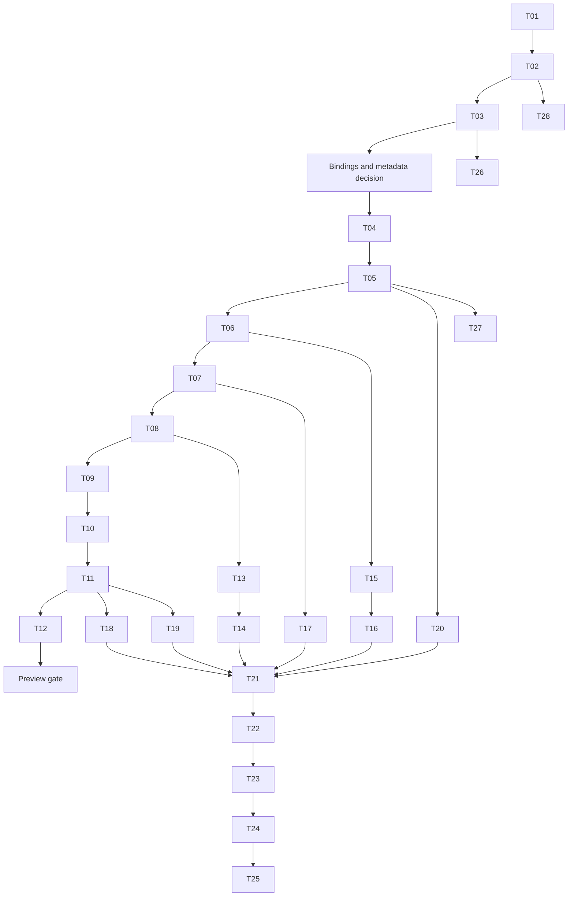

# Implementation plan: tasks and subtasks

Reviewed **24 October 2026**. All tasks are **planned**; none is an implementation result. This backlog implements the [architecture](../architecture/ARCHITECTURE.md) and [parity matrix](PARITY-MATRIX.md). Requirement, verification, and gate definitions are in [traceability](TRACEABILITY.md).

## Execution rules

Each task below identifies dependencies, proposed outputs, numbered subtasks, and acceptance criteria. Output paths are future artifacts inside this .NET repository unless explicitly described as reference evidence. Do not edit the sibling Go checkout to make a differential case pass. Preserve source/spec divergences in a decision record tied to the baseline.

Task completion requires its acceptance criteria, relevant verification artifacts, and documentation updates. A test name alone does not count as a passing result. Record exact commands, tool versions, fixture versions, and outcome at implementation time. Select the .NET test framework/runner in T04 before writing command recipes.

## Milestones and sequencing

| Milestone | Required tasks | Gate / deliverable |
|---|---|---|
| M0 — establish provenance | T01 | G0; complete source/import inventory |
| M1 — close generation and validation design | T02, T03 | G1; selected binding owner, usable package proof, validation decision |
| M2 — useful preview | T04–T12, preview portions of T20–T24 | G2; SnapshotCache + SotW/ADS + real Envoy example |
| M3 — root-library scope | T13–T20 | G3; full service/cache/helper feature matrix |
| M4 — release evidence | T21–T25 | G4 then G5; differential, lifecycle, Envoy, package proof |
| M5 — optional additions | T26, T27, T28 as selected | GV or extension-specific acceptance; no implicit expansion of 1.0 |

T21's harness starts as soon as T02/T04 allow; T12 uses its SotW subset. T22–T24 similarly build incrementally, rather than waiting until feature completion to introduce evidence. Final task dependencies below describe completion prerequisites, not a prohibition on early harness/setup work.

The table and task dependency fields are authoritative; the diagram summarizes the main flow. Preview gate is required before a preview is published, but 1.0 engineering can continue before publication. Independent helper/Linear/client work can overlap after shared contracts stabilize; coordination must avoid competing edits to contract files.

## Epic A — provenance and binding proofs

### T01 — Lock the complete upstream input set

**Scope:** foundation / R01. **Depends on:** none. **Outputs:** `schemas/upstream.lock.json`, `schemas/catalog.json`, provenance report, updated baseline JSON if input data is added.

Subtasks:

- T01.1 Record reviewed Go and Envoy commits, module replacements, and exact source origins for imported schemas.
- T01.2 Trace ratelimit generated descriptors to original schema sources; pin revision and compare service/message definitions.
- T01.3 Inventory standard, legacy, contrib, validation annotation, and custom-extension inputs; classify inclusions/exclusions explicitly.
- T01.4 Record licenses/notices and checksums; document source retrieval without nesting repositories inside another repository's source tree.

**Acceptance:** V01 passes; every generation input has an immutable origin or a documented blocker. No floating source remains in the proposed release catalog. G0 blocks generation acceptance if ratelimit provenance is unresolved.

### T02 — Prove and select the binding provider

**Scope:** foundation / R02, R04. **Depends on:** T01. **Outputs:** provider decision, pinned toolchain/package lock, generation/restore script, descriptor inventory, temporary clean-consumer evidence.

Subtasks:

- T02.1 Evaluate exact-commit existing/Buf SDK coverage, server/client contracts, restore constraints, and dependency identity; do not accept a package by name/version alone.
- T02.2 If that proof fails, generate the selected catalog with pinned protoc/C# gRPC tools and external imports; record compiler limitations/exclusions.
- T02.3 Compile, pack, and consume Protocol from a clean project. Build a listener/HCM/router/TLS resource graph, discovery services, and ratelimit configuration.
- T02.4 Round-trip binary/Any/JSON fixtures, inspect duplicate full names/CLR definitions, and compare normalized descriptors to pinned sources.
- T02.5 Select one provider and document public namespace/package implications; rerun the proof after T03's metadata decision before G1 closes.

**Acceptance:** V02–V04 and the binding portion of V37/V38 pass with exact versions. No overlapping Envoy message definitions are loaded. A usable common extension catalog and required service bases exist. Failed providers have recorded reasons; a new provider is not silently substituted later.

### T03 — Decide Protovalidate metadata and provider direction

**Scope:** mandatory design proof / R23. **Depends on:** T02. **Outputs:** `schemas/validation-assessment.json`, annotated descriptor sample, candidate comparison, ADR10 update.

Subtasks:

- T03.1 Pin and assess `ProtoValidate` and `Celly.Protovalidate` candidates: dependency graph, annotation ownership, rule/CEL coverage, thread/cancellation model, license and maintenance evidence.
- T03.2 Inventory PGV rules in the selected Envoy catalog; run a bounded pinned migration-tool proof on representative required/oneof/map/Any/TTL-related resource schemas.
- T03.3 Prove single-owner descriptor/annotation registration and binary compatibility. Test a representative conforming and violating message with each viable candidate.
- T03.4 Decide the metadata strategy before public binding freeze: dual annotations, a proven external rule overlay, or deferred Envoy validation with an explicit limitation. Record unsupported migrations.
- T03.5 Estimate the remaining T26 work from the inventory, and recommend a provider or document why no provider is yet suitable.

**Acceptance:** V34/V35 have a recorded assessment and bounded proof results; the full GV corpus is not required here. G1 requires a concrete ownership/migration decision, not a promise that adding a runtime validates PGV. If no provider is suitable, Core may proceed with validation explicitly unclaimed.

## Epic B — foundational .NET contracts

### T04 — Establish repository and build structure

**Scope:** preview / R25. **Depends on:** T02, T03. **Outputs:** solution, three runtime/package projects, `global.json`, shared build/package settings, test project layout, scripts, initial CI.

Subtasks:

- T04.1 Pin SDK and package versions; select a .NET test framework/runner and document invocation modes.
- T04.2 Create Protocol/Core/ASP.NET references and public namespaces; optional validator dependencies stay outside Core.
- T04.3 Add formatting/analyzers, nullable policy, deterministic builds, package metadata/license notices, and a clean build/pack script.
- T04.4 Establish fixture and evidence directories plus Linux/macOS/Windows build jobs; keep substantial workflow logic in scripts.

**Acceptance:** A clean build and local package consumption succeed for selected targets. No implementation or test project is omitted from solution/CI discovery. Package graph matches ADR03/04; V37 has an initial smoke result.

### T05 — Implement resource entries, snapshots, and descriptor helpers

**Scope:** preview, Delta primitives for 1.0 / R03, R04. **Depends on:** T04. **Outputs:** Core `Resources/`, snapshot model, registry and version-strategy contracts.

Subtasks:

- T05.1 Implement names/type URLs/resource-family mapping and custom resource naming, TTL entry model, partial per-type snapshots, and custom snapshot interface.
- T05.2 Enforce private stable message ownership; implement safe reads, lazy serialization, and cached resource-version computation.
- T05.3 Implement opt-in source-matching EDS/RDS consistency and reference extraction, including HCM Any handling.
- T05.4 Add scoped descriptor registration and collision checks; define version equality/change semantics and injectable version strategy.

**Acceptance:** V03–V07 pass. Mutating input or returned messages cannot alter built-in published snapshots. Partial snapshots and custom descriptors work; absent resources and unknown default snapshot types have explicit outcomes. No automatic validator/consistency invocation is introduced.

### T06 — Implement one-shot watches and cancellation

**Scope:** preview, both modes / R06. **Depends on:** T05. **Outputs:** `Cache/` watch/subscription-view/response contracts and completion primitives.

Subtasks:

- T06.1 Implement immediate/pending/error watch completion, originating-request/context metadata, lazy and pass-through responses, and read-only subscription views.
- T06.2 Make cancel/dispose idempotent and race-safe; remove registered watches exactly once and run continuations outside cache locks.
- T06.3 Add stream watch-generation identifiers and a bounded-input/per-watch-result delivery design without network writes inside cache calls.
- T06.4 Exercise publication-versus-register, response-versus-cancel, custom-watcher faults, and blocked consumer schedules.

**Acceptance:** V08/V29/V30 pass for primitives. No lost wakeup, double completion, global lock stall, or retained registration after cancellation. A completed watch can be installed safely by the stream before its result is processed.

### T07 — Implement SnapshotCache and status

**Scope:** preview, later Delta/TTL paths extended by T14/T17 / R05, R11. **Depends on:** T06. **Outputs:** SnapshotCache, node hashing, status views, publication/get/clear APIs.

Subtasks:

- T07.1 Implement per-node snapshot storage with default ID hash and custom hasher support.
- T07.2 Implement version/selection/readiness eligibility, immediate and deferred watches, and atomic publication versus watch registration.
- T07.3 Implement copied status, watch counts/timestamps, missing snapshot behavior, and source-equivalent clear semantics.
- T07.4 Capture special ADS missing-name/no-registration behavior and custom snapshot cases in fixtures.

**Acceptance:** V07–V10/V14 pass for SotW. SetSnapshot neither auto-validates nor awaits proxy ACK. Clear behavior and the unusual ADS case match source evidence or have an explicitly accepted divergence record.

## Epic C — SotW preview

### T08 — Implement SotW subscription transitions

**Scope:** preview / R07. **Depends on:** T05, T06. **Outputs:** SotW subscription state and option model.

Subtasks:

- T08.1 Implement legacy empty-as-wildcard initialization, explicit `*`, named and prefix sets, and returned-resource cleanup.
- T08.2 Implement global/per-type legacy-wildcard deactivation with source defaults.
- T08.3 Preserve unsubscribe/re-subscribe behavior without a version change and invalidate stale generation/subscription responses.

**Acceptance:** V10/V11 pass as transition tables. Explicit subscriptions prevent later empty SotW requests from reactivating legacy wildcard. Prefix and exact names are not conflated.

### T09 — Implement the SotW stream engine and callbacks

**Scope:** preview / R08, R10. **Depends on:** T07, T08. **Outputs:** transport-independent SotW session loop and callback contracts.

Subtasks:

- T09.1 Implement reader/event-loop/writer lifecycle, node carry-forward, implied type URL, and ADS required-type rejection.
- T09.2 Implement source callback ordering, stale-nonce request handling, watch replacement, response filtering, nonce assignment, and send metadata updates.
- T09.3 Implement request/open rejection and response/close fault policy; preserve close notification on rejected open and dispose all paths.
- T09.4 Add per-stream tests for version changes, NACK/no rollback, later node replacement, immediate cache response, and blocked writer behavior.

**Acceptance:** V10–V12/V15/V28/V29 pass. Exactly one writer acts on each stream. Request callbacks still see stale requests at the source-equivalent point. No new automatic NACK rollback or retry policy appears.

### T10 — Implement SotW ADS readiness and optional ordering

**Scope:** preview / R09. **Depends on:** T09. **Outputs:** ADS dispatch, ordered policy, custom type handling.

Subtasks:

- T10.1 Multiplex independent per-type state with stream-wide nonce uniqueness and default unordered behavior.
- T10.2 Port ordered ADS response draining/resource priority and SnapshotCache readiness as separate options.
- T10.3 Handle superseded current-type responses while preserving other-type progress; cover unsubscribe races and arbitrary custom type URLs.

**Acceptance:** V09/V12/V13/V30 pass for both ordering settings. No atomic cross-type claim; no stale unsubscribed SotW resource is sent. Known-resource array sizing does not break custom ADS types.

### T11 — Build the ASP.NET Core streaming host

**Scope:** preview / R21. **Depends on:** T10. **Outputs:** ASP.NET package service adapters, DI/endpoint APIs, minimal host/example bootstrap.

Subtasks:

- T11.1 Map preview SotW service methods and ADS to engines with generated contracts, caller-owned cache, and explicit option lifetimes.
- T11.2 Wire call/host cancellation, scoped callback factory, option validation, and owned-resource disposal.
- T11.3 Expose documented authentication/authorization and host limit hooks; provide an example configuration update source and safe default logs.
- T11.4 Prove actual HTTP/2 gRPC loopback rather than only direct method calls.

**Acceptance:** V15/V28/V29 pass for preview methods. Endpoint inventory matches advertised preview scope. Application-owned channels/caches are not unexpectedly disposed; host shutdown leaves no watches/tasks.

### T12 — Deliver the preview vertical slice

**Scope:** preview / R22. **Depends on:** T11, T20. **Outputs:** runnable example, preview compatibility manifest, initial differential/Envoy evidence, preview usage guide.

Subtasks:

- T12.1 Use T21's initial harness for SotW snapshots, subscriptions, callbacks, and ordering cases.
- T12.2 Use T23's preview Envoy setup to bootstrap a listener/cluster/route/endpoint graph, apply a live update, provoke a NACK, and reconnect.
- T12.3 Use T24's clean package consumer and document exact subset, pins, known limitations, and commands.

**Acceptance:** G2 passes with the required preview portions of V01–V15/V28–V31/V37/V38. A real proxy serves the expected changed backend/configuration. No Delta/fetch/full-parity claim is made for this release.

## Epic D — complete the root-library scope

### T13 — Implement Delta subscription state

**Scope:** 1.0 / R12. **Depends on:** T08. **Outputs:** Delta subscription transitions and initial-version state.

Subtasks:

- T13.1 Seed initial resource versions only on the first request for each type; implement exact/prefix/wildcard additions and removals.
- T13.2 Preserve source legacy-wildcard transitions and the explicit-name unsubscribe while wildcard remains active case.
- T13.3 Specify returned-resource metadata updates and reconnect initialization using source traces.

**Acceptance:** V16 passes, including empty initialization, overlapping subscribe/unsubscribe, prefix removal, wildcard deactivation, and re-subscribe without a resource change.

### T14 — Implement Delta cache responses, streams, and ADS

**Scope:** 1.0 / R13, R10. **Depends on:** T07, T09, T13. **Outputs:** Delta cache eligibility/version maps, session loop, per-type/ADS service adapters.

Subtasks:

- T14.1 Implement changed resources/removals/system version, initial empty wildcard reply, lazy version maps, and pass-through Delta envelopes.
- T14.2 Drain pending responses before subscription mutation; serialize sends and update returned tracking at the source-equivalent stage.
- T14.3 Preserve Delta-specific callback order and nonce/NACK behavior without importing SotW stale filtering or a fabricated ACK ledger.
- T14.4 Map all standard Delta services plus VHDS/LEDS and ADS; do not invent a dedicated rate-limit Delta RPC or ordered-Delta option.

**Acceptance:** V16–V18/V28/V29 pass. Reconnect initial versions suppress unchanged resources; removals and wildcard edge cases converge. Every Delta RPC matrix row has adapter and transport evidence.

### T15 — Implement LinearCache

**Scope:** 1.0 / R14. **Depends on:** T06, T13. **Outputs:** single-type resource collection and SotW/Delta watch indexes.

Subtasks:

- T15.1 Implement initial resources, update/delete, bulk changes, and replace-all with stable ownership.
- T15.2 Implement version prefix/counter, source no-op behavior, resource hashes, exact/prefix/wildcard indexes, and validation of request type URL.
- T15.3 Implement cancellation/status-relevant cleanup and unsupported Fetch behavior.

**Acceptance:** V19/V30 pass for both modes, concurrent update/cancel and no-op operations. Fetch exposes the unsupported operation; a restart/version prefix scenario avoids pretending counter identity is globally stable.

### T16 — Implement MuxCache

**Scope:** 1.0 / R15. **Depends on:** T07, T15. **Outputs:** classifier and child-cache routing APIs.

Subtasks:

- T16.1 Implement separate SotW/Delta classifiers and source-equivalent fetch delegation.
- T16.2 Implement missing classification errors, cancellation delegation, custom child cache support, and ownership rules.
- T16.3 Exercise mixed Snapshot/Linear children and parallel routes without cross-cache locking.

**Acceptance:** V20 passes for routing, missing key, child errors and Linear fetch limitation. Cancellation reaches exactly the selected child and does not affect unrelated streams.

### T17 — Implement TTL wrapping and SotW heartbeat scheduling

**Scope:** 1.0 / R16. **Depends on:** T07, T14. **Outputs:** TTL materialization and TimeProvider-backed cache timer.

Subtasks:

- T17.1 Encode SotW and Delta TTL resources, versions, normal payloads, and payload-free heartbeat representations.
- T17.2 Implement source-equivalent periodic SotW watch scanning/selection and one-shot completion with returned metadata retained.
- T17.3 Implement timer enablement/interval validation, disposal, fake-clock cases, and no cache-side automatic TTL deletion.
- T17.4 Document that automatic Delta heartbeat scheduling is outside the pinned source behavior.

**Acceptance:** V21/V22/V29 pass, including prefix selection behavior actually observed in source and shutdown races. V33 later establishes real proxy refresh/expiry; fake-clock cases alone do not close interop.

### T18 — Implement unary Fetch and HTTP gateway

**Scope:** 1.0 / R17, R18. **Depends on:** T07, T11, T16. **Outputs:** shared fetch engine, unary service adapters, opt-in eight-route HTTP mapping.

Subtasks:

- T18.1 Implement source request/response fetch callbacks and cache result/error propagation; map eight standard unary methods plus ratelimit FetchRlsConfigs.
- T18.2 Implement route cleaning/type override and protobuf JSON with registered Any descriptors; compare parser/formatter behavior to Go fixtures.
- T18.3 Preserve 200/304/400/404/500 behavior and absent response body on 304; document host method/body-size/content-type differences.
- T18.4 Map rate-limit SotW StreamRlsConfigs and test its dedicated RPC asymmetry; do not add a rate-limit HTTP route.

**Acceptance:** V23–V25/V28 pass. Both fetch transports share semantics, unsupported child fetch remains visible, and all RPC/routes match the matrix including negative endpoint inventory.

### T19 — Implement the focused SotW ADS client

**Scope:** 1.0 / R19. **Depends on:** T04, T09. **Outputs:** ADS client wrapper and error classification.

Subtasks:

- T19.1 Accept caller-owned call invoker, fixed node/type, and open/send initial request during initialization.
- T19.2 Track last received and last accepted responses for receive/ACK/NACK; serialize operations and define reinitialization/use-before-init behavior.
- T19.3 Classify EOF/Unavailable/Canceled, dispose calls only, and expose errors without automatic reconnection.

**Acceptance:** V26 passes against scripted and loopback servers. NACK retains accepted version with latest received nonce; ACK advances acceptance; external channel remains usable after wrapper disposal.

### T20 — Complete resource, conversion, and well-known helpers

**Scope:** preview resource subset; 1.0 complete / R20. **Depends on:** T05. **Outputs:** helper APIs and source-to-.NET symbol mapping.

Subtasks:

- T20.1 Inventory name/type/reference and well-known constants; port public useful surface without mechanical Go logging/vtprotobuf facades.
- T20.2 Implement message/Struct conversion using protobuf JSON semantics and custom descriptor registry.
- T20.3 Verify HCM/Any references, unknown descriptor errors, null/default/presence cases, and helper usage in the example.

**Acceptance:** V27 passes; preview-required name/reference helpers exist before T12. Each upstream helper is mapped, explicitly .NET-specific, or excluded with rationale in the compatibility report.

## Epic E — verification and release engineering

### T21 — Build the Go/.NET differential harness

**Scope:** preview subset then 1.0 / R22. **Depends on for completion:** T14–T20. **Outputs:** scripted scenario format, pinned Go driver, .NET driver, semantic trace comparer, divergence reports.

Subtasks:

- T21.1 Start with cache/SotW cases after T04, retaining original source fixtures and licensing; add each feature as it lands.
- T21.2 Capture requests/responses, callback points, errors, status, and watch lifecycle; preserve ordering where meaningful.
- T21.3 Normalize opaque values through stable relationship-preserving mappings, and prove the comparer rejects injected stale/nonmatching associations.
- T21.4 Run the root matrix including unsupported operations and source/spec differences; assign an explicit disposition to every divergence.

**Acceptance:** Required V05–V27 cases compare successfully or have an accepted intentional .NET departure. A self-consistent .NET-only trace cannot substitute for the Go driver. No unresolved material protocol divergence passes G3/G4.

### T22 — Exercise concurrency, callbacks, and cleanup

**Scope:** preview subset then 1.0 / R06, R10, R11, R21, R22. **Depends on for completion:** T21. **Outputs:** deterministic schedule fixtures and lifecycle/stress evidence.

Subtasks:

- T22.1 Force register/publish/cancel/send/unsubscribe races, immediate responses, multiple nodes/types, and custom watcher misbehavior using barriers.
- T22.2 Block a writer and callback, reenter publication from a callback, trigger all rejection/failure paths, and stop the host mid-operation.
- T22.3 Assert no leaked watches/tasks/timers, correct status counts and close-once behavior, and unrelated-stream progress; document bounded-limit outcomes.
- T22.4 Run repeated transport stress with recorded seed, counts, duration and memory/watch trends; classify timeouts as failures.

**Acceptance:** V14/V15/V28–V30 pass with explicit leak/progress assertions. Repetition supplements deterministic cases and does not establish an unmeasured throughput SLA.

### T23 — Prove compatibility with released Envoy binaries

**Scope:** preview SotW subset then 1.0 / R22. **Depends on for completion:** T22. **Outputs:** pinned image matrix, bootstrap files, interop scripts and traffic/admin evidence.

Subtasks:

- T23.1 Select supported released Envoy versions and immutable image digests, independent of the latest schema source; record architecture/platform.
- T23.2 Establish SotW/ADS bootstrap, live endpoint/route changes, NACK of a deliberately rejected config, reconnect/resubscribe, and traffic convergence.
- T23.3 Establish Delta/ADS update/removal/initial-version reconnect and type coverage with observable proxy state.
- T23.4 Demonstrate TTL refresh then expiry without resending configuration; inspect config dump/admin counters and application traffic.

**Acceptance:** V31–V33 pass for the advertised matrix. Reports tie each result to library/Go/schema/image pins. Unsupported schema features on an older proxy are listed explicitly rather than hidden by a successful initial connection.

### T24 — Complete packaging, CI, and upstream-update tooling

**Scope:** preview subset then 1.0 / R25. **Depends on for completion:** T23. **Outputs:** package/regeneration/update scripts, CI jobs, clean-consumer and compatibility manifests.

Subtasks:

- T24.1 Build/pack/restore packages in a clean environment, verify XML docs/symbols/license notices and transitive targets, and inspect dependency ownership.
- T24.2 Gate regeneration/catalog/descriptor drift and pin toolchains/actions; verify selected platforms, generated source policy, and reproducible inputs.
- T24.3 Implement upstream old/new behavior/schema diff reporting and required scenario selection without rewriting past evidence.
- T24.4 Publish CI evidence artifacts and document local reproduction; configure secrets/permissions only when publication needs them.

**Acceptance:** V01–V04/V37/V38 pass with the full package graph. Core-only consumers lack ASP.NET hosting and CEL runtime dependencies. A deliberate changed schema/input lock is detected by the drift job.

### T25 — Review scope and prepare the 1.0 release

**Scope:** 1.0 / R01, R22, R25. **Depends on:** T12, T24. **Outputs:** final API review, usage/migration docs, compatibility report, release checklist and candidate packages.

Subtasks:

- T25.1 Reconcile all parity rows and public extension points with tasks/evidence; record intentional .NET departures, unsupported operations, and optional scope.
- T25.2 Review public API/versioning, cancellation/ownership/error contracts, package names and supported targets before publishing.
- T25.3 Close release-blocking defects and rerun affected gates; obtain review of the concrete candidate and its evidence.
- T25.4 Prepare release notes and publish only through an explicitly authorized repository/package workflow; repository branding/remote visibility are resolved before that step.

**Acceptance:** G3/G4/G5 pass; no planned or failed case is represented as verified. Docs give exact supported behavior/schema/proxy axes and operational examples. Preparing the candidate does not itself authorize package publication.

## Epic F — separately scoped extensions

### T26 — Implement the optional Protovalidate adapter

**Scope:** optional addon / R24. **Depends on:** T03, T07, T15, T24. **Outputs:** optional adapter package, validated-publication decorators, migration/rule inventory, conformance report.

Subtasks:

- T26.1 Integrate the selected pinned runtime behind IResourceValidator and prove single annotation/message ownership with clean package consumers.
- T26.2 Expand the controlled metadata migration over the selected catalog; compare normalized descriptors and original Go PGV versus migrated .NET outcomes.
- T26.3 Implement structured violations, unsupported-rule/runtime fault separation, limits, initialization, concurrency reuse and cancellation behavior.
- T26.4 Implement all-or-nothing snapshot/batch publication outside locks and explicit disabled/default behavior.
- T26.5 Run official conformance plus the Envoy rule corpus; document exact exclusions and residual semantic differences before enabling an Envoy-validation claim.

**Acceptance:** GV/V34–V36/V37 pass. No CEL runtime enters Core-only consumers. Missing annotations and unsupported rules never masquerade as validation success. Estimate separately after T03; root 1.0 is not blocked if this addon remains explicitly unclaimed.

### T27 — Port the standalone xDS matcher if selected

**Scope:** optional / R26. **Depends on:** T05, T20, T24. **Outputs:** separate matcher package and registry/legacy conversion fixtures.

Subtasks:

- T27.1 Inventory upstream matcher public surface, input/matcher extension registry and match-tree evaluation behavior.
- T27.2 Implement supported evaluation and legacy-format conversion with custom registration extension points.
- T27.3 Compare Go fixtures and failure/unsupported-extension behavior, package separately, and publish a precise supported subset.

**Acceptance:** V39 passes for the selected matrix. No whole-repository parity claim follows merely from adding the package.

### T28 — Expand contrib or legacy generated catalogs if selected

**Scope:** optional / R26. **Depends on:** T02, T24. **Outputs:** expanded schema manifest and packages with nonoverlapping message ownership.

Subtasks:

- T28.1 Obtain a named consumer requirement and enumerate schemas/services to add; distinguish generated legacy messages from a legacy control-plane runtime.
- T28.2 Prove descriptor/package dependency boundaries without duplicate common types, pin sources, and record additional licensing/tooling constraints.
- T28.3 Run binary/Any/JSON/consumer cases and update the compatibility catalog with explicit exclusions.

**Acceptance:** V40/V37/V38 pass. No v2 server behavior is claimed from generating v2 classes. Required extension payloads load with the existing registry and provider.

## Estimates and checkpoint decisions

The earlier proposal's **21–35 engineer-days before contingency**, **2–3 engineer-weeks for preview**, and **6–10 engineer-weeks for root 1.0 including contingency** remain provisional judgments. Tasks above decompose those work packages; they are not additional estimates to sum on top. Differential/CI/interop work is developed incrementally and was already included.

The bounded T03 assessment shares the initial 2–4 day proof checkpoint; if schema retrieval or validation metadata makes that infeasible, stop using that checkpoint estimate and revise it with evidence. T26–T28 implementation and any runtime remediation are excluded from the root estimate. Do not assign precise dates before T02/T03 demonstrate catalog and metadata feasibility.

Re-estimate at G1 from actual generation/restore/consumer results, after G2 from measured preview throughput and remaining cases, and before G5 from unresolved defects and supported proxy matrix. Scope/target/provider changes produce an updated decision record and estimate; they are not hidden contingency consumption.
